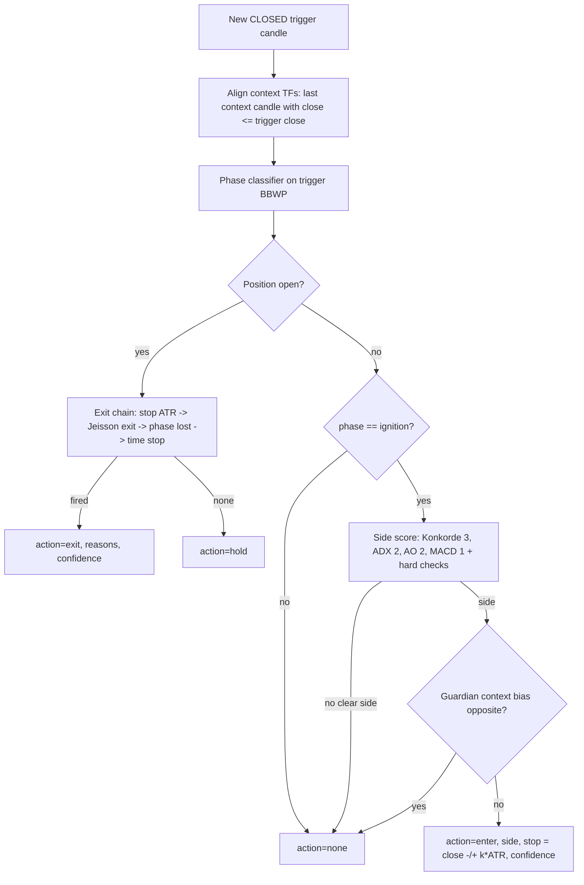

# Impulse engine v2 ("impulsos-v2") — rule spec

| | |
|---|---|
| **rule_version** | `impulse-2.0.0` (round 1, sections a-h) -> **`impulse-2.1.0`** (round 2, section "Round 2" at the end) |
| **Status** | Spec for `backend`. NOT active. Paper-first gates in §h / §R2.k. |
| **Author / date** | trading analyst, 2026-11-01 (branch `impulsos-v2`, after Konkorde audit `406b69c`) |
| **Goldens** | `tests/fixtures/impulse_golden_cases.json` (14 vote cases, regression) + `tests/test_impulse_sequential.py` (S01-S11 sequential, rule-derived) |
| **Scope** | NEW additive engine. `rules_service.py` (legacy vote engine) and its watcher output stay untouched. |
| **Round 2 status** | BUILT and BACKTESTED 2026-11-01 (`ecd603b`): **no cell passes** — see "Round 2 results" at the end. |
| **Round 4b status** | `impulse-2.2.0` (exits without `phase_lost`, SNIPPER 10x isolated) BUILT and BACKTESTED 2026-11-01 (`25071ba`): **PRO INCONCLUSIVE (n 14), SNIPPER NO-GO at every leverage, 1 liquidation at 10x** — see "Round 4b results". |
| **Round 5 status** | `impulse-2.3.0` (ENTRY filters on the frozen 2.2.0 chain: ADX turn / A-grade origin, AO divergence trigger / any TF, BBWP fresh ignition / from blue) BUILT and BACKTESTED 2026-11-01 (`978a246`): **no cell GO, every filtered cell INCONCLUSIVE by n; classifier on snipper: `adx_turn` DROP, `bbwp_fresh` DROP, `bbwp_fresh_blue` weak KEEP (passed ≈ 0 R, rejected −0.39 R)** — see "Round 5 results". |
| **Round 6 status** | ABLATIONS on the frozen 2.3.0 baseline (no new rule): guardian ML RSI exit ON vs OFF (owner point f) and SNIPPER 1h 10x isolated vs 5x cross, risk- and margin-sized (owner points b/c). Pre-registered in `docs/PREREG_IMPULSOS_v2_r6.md`. ⚠️ **E20**: rounds 4b/5 ran with the TRIGGER ML RSI gate OFF (harness default); round 6 runs both readings. ML RSI port audit: `docs/impulsos-v2-ml-rsi-audit.md`. Results in "Round 6 results" after the run. |

> **SUPERSEDED where they conflict (2026-11-01).** Round 1 (sections a-h,
> `impulse-2.0.0`) is kept as the record of what was tested and refuted.
> Round 2 (`impulse-2.1.0`, last section) replaces: the Konkorde line
> (`edge` -> `verde`), the side vote of §c (-> sequential leader/follower
> machine), the single-entry sizing and exit chain of §d/§f (-> PRO re-buys,
> wide invalidation, no 1.5 ATR stop, no 30-bar time stop) and the profile
> scope (PRO 4h + PRO read on 1d). §b phases, §e alignment rules and §g
> costs/split are reused unchanged unless Round 2 says otherwise.

Owner (Jeisson) does not hold longs: he trades **impulses in both directions**.
The legacy engine (sign vote, entry = buy, exit = leave the long) cannot short and
cannot see turns. This engine models one impulse cycle per trigger timeframe:
**compression -> ignition -> expansion -> exhaustion -> contraction**, with the
trade opened at ignition (side decided by Konkorde/ADX/AO/MACD, filtered by the
context timeframes) and closed by the owner's exit rule or a protective exit.

Reused, not reinvented: spec §0 (closed candles, multi-TF alignment, TF bands,
rule_version), E1 `adx_turn`, E2 `ao_divergence` + AO zero-cross, E5 regime
(>50) and its addenda (zones, `v_turn_low` low zone = 30, `zone_jump`), §F
ladder (guardian TF), §H profiles. Forbidden and NOT used: FEC/FEP and any
false-entry machinery (decisions.md D16/D17).

---

## a. Model and flow



Output of every evaluation (one per symbol x profile x closed trigger candle):

```json
{"rule_version": "impulse-2.0.0", "symbol": "BTC/USDT", "profile": "pro",
 "trigger_tf": "4h", "candle_close": "2026-10-31T20:00:00Z",
 "action": "enter|exit|hold|none", "side": "long|short|none", "phase": "...",
 "confidence": 0.0, "reasons": ["..."], "side_score": 0.0,
 "context_bias": {"1d": 1, "1w": 0}, "stop_price": null, "exit_price": null}
```

Engine reads dataframe columns (not the `/v1/metrics` result dict). Exact names
(verified `indicators_service.py`): `close, high, low, bbwp` (definition
`"tv"` = `bbwp_owner.py`, SMA13 basis, lookback 256, MA5 — the rule doc must
pin `bbwp_definition: "tv"`), `konkorde_marron, konkorde_media,
konkorde_azul, konkorde_verde, adx14, plus_di, minus_di, ao, macd,
macd_signal, atr14`. Gotcha: the df column is `atr14` but the result-dict key
is `atr`; use the df.

Notation: `x[-1]` = last CLOSED candle (spec §0.1). Forming candle dropped
before computing anything.

### Konkorde line choice (decision)

> **SUPERSEDED in `impulse-2.1.0`**: the owner validated against TradingView
> Konkorde 2.0 that the line that crosses 0 is `konkorde_verde` (yellow
> area). See §R2.a. The text below is the round-1 record.

`edge = konkorde_marron - konkorde_media` is THE Konkorde line of this engine,
for both side and exit. **Why**: it is Blai5's own signal (marron/media
cross), it is centred on zero on every TF (marron itself sits ~+55 and the
"cross of 0" on it is meaningless after D18), and it is what
`_classify_konkorde` already uses; `azul` (NVI) only moves on low-volume bars
(step-like, noisy) so it is a strength qualifier (`strong_hands`), not the
trigger. `oscp` (verde - marron) is not used in v2.0.0.

---

## b. Phases by BBWP (trigger TF, closed candles)

| Phase | Condition (evaluated top-down, first match wins) | Meaning |
|---|---|---|
| `exhaustion` | `bbwp[-1] >= 90` OR (`max(bbwp[-3..-1]) >= 90` AND a `red_drop` event in the last 3 bars) | red zone / rollover from it |
| `ignition` | `bbwp[-1] > 50` AND `breakout_age <= 2` AND `compression_recent` AND `bbwp > 50` on every bar since the cross | leaving compression = impulse born |
| `expansion` | `bbwp[-1] > 50` | impulse running (owner filter >50) |
| `compression` | `bbwp[-1] <= 30` | spring loading (E5 addendum `low_zone_abs`) |
| `contraction` | `30 < bbwp[-1] <= 50` AND `max(bbwp[-10..-2]) > 50` | volatility leaving the regime |
| `building` | otherwise (`30 < bbwp[-1] <= 50`, no recent >50) | neutral |

Definitions:

* `compression_recent` = `min(bbwp[-10..-1]) <= 30` (`compression_max=30`,
  `compression_lookback=10` bars, current bar included).
* `breakout` (the owner's >50 filter as an EVENT): bar `c` with
  `bbwp[c-1] <= 50 < bbwp[c]`; `breakout_age = index(-1) - c`;
  `breakout_ttl = 3` bars (age 0, 1, 2 allowed).
* `red_drop` event at bar `k`: `bbwp[k-1] >= 90` AND `bbwp[k-1] - bbwp[k] >= 8`
  (one single candle; 7.9 does not count).
* `zone_jump` (E5 addendum): the breakout bar skips >= 2 zones
  (blue[0,20) -> yellow[50,80) or red). Only feeds confidence.
* Entry is forbidden at `bbwp[-1] >= 90` (late: phase is `exhaustion` anyway).

---

## c. Side rule

> **SUPERSEDED in `impulse-2.1.0`** by the sequential machine (§R2.b): the
> owner's strategy is not a vote. Kept as the `model="vote"` regression path.

Four votes `v in {-1, 0, +1}` on the trigger TF, closed bar `-1`:

| Element | Weight | +1 (long) | -1 (short) | Band |
|---|---|---|---|---|
| Konkorde edge | 3 | `edge[-1] > 0` AND `edge[-1] > edge[-2]` | `edge[-1] < 0` AND `edge[-1] < edge[-2]` | `high_tf` only (§0.3) |
| ADX | 2 | `plus_di > minus_di` AND `adx_slope3 >= 0.5` | `minus_di > plus_di` AND `adx_slope3 >= 0.5` | both |
| AO | 2 | (`ao > 0` AND `ao[-1] > ao[-2]`) OR `ao_divergence_bullish` active (E2, ttl 10) | mirror (`ao < 0` falling, or bearish divergence active) | both |
| MACD | 1 | `macd > macd_signal` | `macd < macd_signal` | both |

`adx_slope3 = (adx14[-1] - adx14[-4]) / 3` (E1 `turn_window=3`; 0.5 pts/bar =
"ADX rising", half of E1 `min_slope`). If AO is positive-rising AND a bearish
divergence is active (or mirror), AO vote = 0.

`S = sum(w * v) / sum(w)` with `sum(w) = 8` on `high_tf`, `5` on `low_tf`
(Konkorde removed, reason `band_konkorde_excluded`).

Side resolution (all required, else `side = none`, reason `side_ambiguous`):

1. `S >= +0.5` -> long candidate; `S <= -0.5` -> short candidate
   (`low_tf`: threshold 0.6, because only 5 weight points remain).
2. Hard: dominant DI agrees with the side (`plus_di > minus_di` for long).
   Else `di_against_side`.
3. Hard (`high_tf`): Konkorde vote is not against the side. Else
   `konkorde_against_side`.

No weighted tie-breaking, no "best guess": if no clear side -> no entry.

---

## d. Entry, exit and confidence

> **SUPERSEDED in `impulse-2.1.0`** for the sequential model: entry §R2.b,
> re-buys §R2.c, exit chain §R2.d (no `exit_stop_atr`, time stop >= 60 bars).

### Entry (position flat)

`enter(side)` iff ALL:

1. `phase == ignition` (implies compression_recent + breakout within 3 bars + BBWP > 50 and < 90);
2. side resolved per §c;
3. context permits the side (§e).

Fill = `close[-1]`. `stop_price = close[-1] -/+ stop_atr_mult(profile) * atr14[-1]`.
`1R = |entry - stop_price|`. No fixed target (exit by rule, §f). One position
per symbol x profile; no pyramiding; no automatic flip (§F); a new entry needs a
new compression -> ignition cycle.

Reasons emitted on entry (codes): `bbwp_compression_recent`,
`bbwp_breakout_from_compression`, optional `bbwp_zone_jump`; the agreeing votes
`konkorde_edge_positive|negative`, `adx_di_bullish|bearish`, `ao_bullish|bearish`,
`macd_bullish|bearish`; optional `adx_turn_up`, `konkorde_edge_cross_up|down`,
`ao_zero_cross_up|down`, `konkorde_strong_hands_agree`,
`ao_divergence_bullish|bearish`; context `context_aligned` (guardian bias ==
side) or `context_neutral`.

No-entry reasons: `no_compression_breakout`, `side_ambiguous`,
`di_against_side`, `konkorde_against_side`, `context_against`,
`context_missing`, `band_konkorde_excluded` (informational).

### Exit chain (position open; first match wins, evaluated on the closed bar)

| # | Code | Rule | Fill (backtest) | confidence |
|---|---|---|---|---|
| 1 | `exit_stop_atr` | long: `low[-1] <= stop_price`; short: `high[-1] >= stop_price` | `stop_price`, or `open` if it gapped beyond | 1.0 |
| 2 | `exit_rule_jeisson` (+ `exit_bbwp_red_drop`, + `exit_konkorde_cross_against` / `exit_ao_cross_against`) | a `red_drop` event AND an against-cross event, both inside the last 3 closed bars (`-3..-1`), at least one of them ON bar `-1` (order free) | `close[-1]` | `0.6 + 0.2*min(1,(drop-8)/12) + 0.2*g`, `g=1` same bar, `0.5` one bar apart, `0` two apart |
| 3 | `exit_phase_lost` | `bbwp[-1] <= 50` AND trend line against (high_tf: `edge[-1] < 0` for long / `> 0` for short; low_tf: `ao` sign against) | `close[-1]` | 0.6 |
| 4 | `exit_time_stop` | `bars_held >= time_stop_bars(profile)` AND unrealised `< +0.5 R` | `close[-1]` | 0.5 |

Against-cross event at bar `j` (the owner's "Konkorde girando contra la
posición y cruzando el 0"):

* long: `edge[j-1] >= 0 AND edge[j] < 0` (+ -> -)
* short: `edge[j-1] <= 0 AND edge[j] > 0` (- -> +)
* `low_tf` profiles (Konkorde banned below 4h, §0.3): the leg is the AO zero
  cross against (`ao_zero_cross_down` for long / `_up` for short, E2 semantics),
  code `exit_ao_cross_against`. **Assumption, owner to confirm.**

Window semantics, explicit: drop on bar 1 and cross on bar 3 -> exit at bar 3;
cross on bar 4 -> NO exit (drop left the window). A 7-point drop never counts.
`bars_held` = closed trigger bars since the entry bar (entry bar = 0).

Hold (no exit fired): reason `hold_exit_incomplete` if exactly one Jeisson leg
is inside the window; else `hold_expansion_healthy` if phase in
{ignition, expansion} and `S_dir > 0`; else `hold_no_exit_condition`.
`S_dir` = side score signed toward the open position (no hard checks).

### Confidence (0-1, reported; NOT a gate in 2.0.0 — backtest stratifies by tercile)

Entry:

```
confidence = clamp(0.35*|S| + 0.20*ctx_frac + 0.15*ignition_q
                   + 0.10*adx_turn + 0.10*fresh_cross + 0.10*strong_hands, 0, 1)
```

* `ctx_frac` = context TFs with bias == side / context TFs with data.
* `ignition_q` = 1 if `min(bbwp[-10..-1]) <= 20` (blue) or `zone_jump` on the breakout bar.
* `adx_turn` = 1 if E1 `adx_turn_up` (defaults 3/5/1.0/1.5/10) with DI on the side, at bar -1.
* `fresh_cross` = high_tf: edge crossed 0 toward the side within the last 5 bars; low_tf: AO zero cross toward the side within 5 bars.
* `strong_hands` = high_tf: `sign(konkorde_azul[-1]) == side`; low_tf: E2 divergence toward the side active.

Hold: `0.5*max(0, S_dir) + 0.5*[phase in {ignition, expansion}]`. Exit: table above.

---

## e. Multi-TF context

Per context TF (closed per §0.2: a context candle counts only if its close time
<= trigger candle close time; e.g. 4h trigger closing 08:00 uses the 1d candle
that closed 00:00, never the forming day):

```
ctx_score = 3*sign(edge) + 2*sign(plus_di - minus_di) + 2*sign(ao) + 1*sign(macd - macd_signal)
bias = +1 if ctx_score >= +3 ; -1 if ctx_score <= -3 ; else 0      (NaN component -> 0)
```

* **Guardian** = first context TF of the profile (§F ladder). A side is
  allowed iff `guardian_bias != -side`. Guardian all-NaN -> `context_missing`, no entry.
* Higher context TFs only move `ctx_frac` (conviction cascade, §F). They never
  block in 2.0.0.
* Data gotcha: 1M Konkorde needs ~105 monthly bars and BBWP 256 months — not
  available on bitget BTC/USDT; 1M bias will be NaN (ignored, logged). 1w BBWP
  needs ~256 weeks of warmup: fetch from 2019 or BBWP context is NaN (BBWP is
  not used in context anyway).

---

## f. Profiles

Rule of the owner: wider zoom = less leverage. Leverage never changes signals,
only sizing (`sizing_profiles` parity). Position size = `equity * risk% / 1R`;
if notional / equity would exceed max leverage, size DOWN (never widen the
stop). Liquidation guard: `stop distance <= 0.5 * (1 / leverage)` or skip.

| Profile | Trigger TF | Context (guardian first) | Band | Max lev | Margin | Risk / trade | Stop ATR mult | Exit policy | time_stop_bars | Watcher cadence |
|---|---|---|---|---|---|---|---|---|---|---|
| `scalper` (NEW) | 15m | 1h, 4h | low_tf | 10x | isolated | 0.25% | 2.0 | no target, exit chain (AO leg) | 32 (8h) | every 15m close +30s |
| `snipper` | 1h | 4h, 1d | low_tf | 10x | isolated | 0.50% | 1.5 | no target, exit chain (AO leg) | 48 (2d) | every 1h close +30s |
| `pro` | 4h | 1d, 1w | high_tf | 5x | isolated (see note) | 0.75% | 1.5 | no target, exit chain | 30 (5d) | every 4h close +60s |
| `ancient` | 1d | 1w, 1M | high_tf | 2x (default 1x) | isolated | 1.00% | 2.0 | no target, exit chain | 30 (30d) | daily 00:05 UTC |

* **scalper**: E16 fee drag at 15m is the worst of the ladder (~0.45 R at
  2.0 ATR, extrapolated from 30m 0.41 R at 1.5 ATR) — wider stop to cut drag,
  smallest risk, leverage capped at snipper's 10x (not higher) because low TF
  noise plus leverage is how accounts die; expected NO-PASS on costs until
  proven otherwise. 1h is an alignment TF (same low band), 4h is the guardian.
* **snipper**: keeps today's 10x isolated cap; 1h band forbids Konkorde, so
  side = ADX/AO/MACD only, guardian 4h carries Konkorde.
* **pro**: today's mmk-api has 5x **cross**; recommend isolated during paper so
  one bad trade cannot drain the account — leverage cap unchanged.
* **ancient**: §H said 0x, mmk-api caps 2x; shorts are impossible on spot, so
  ancient shorts need perps at >= 1x. Proposal: longs spot 1x, shorts perp 1x,
  2x only after live-tiny gate.

---

## g. Backtest protocol (PRE-REGISTERED — no parameter change after first run)

* **Market / data**: BTC/USDT, bitget spot OHLCV via `market_data_service`
  (ccxt). Warmup fetched before the window (>= 300 trigger bars; 1w from 2019).
* **Window**: 2024-11-01 00:00 UTC -> 2026-10-31 23:59 UTC.
  **In-sample** 2024-11-01 -> 2025-12-31 (14 months); **out-of-sample**
  2026-01-01 -> 2026-10-31 (10 months). Parameters are set a priori in this
  doc (nothing is fitted on IS); the split is a stability check. Any change
  after seeing results = new `rule_version` + new pre-registration.
* **Cells**: profile x direction: `pro@4h` long, `pro@4h` short,
  `ancient@1d` long, `ancient@1d` short (mandatory). `snipper@1h` and
  `scalper@15m` optional/informational in this run (must pass their own run
  before paper).
* **Execution model**: signal on bar close, fill at `close` + 0.05% slippage;
  fee 0.10% per side (conservative spot taker); stop fills at stop or worse
  open; when stop and rule exit coincide on a bar, stop wins (worst case).
  Perp funding 0.01% per 8h held charged to every short and every leveraged
  trade, regardless of sign (conservative). Costs in R:
  `cost_R = (fee + slip) * (entry + exit) / stop_distance` (E16,
  `SetupBacktestService._simulate_outcome`). Declared drag (E16, 1.5 ATR):
  1h 0.28 R, 4h 0.14 R, 1d 0.055 R per round trip (ancient at 2.0 ATR ~0.04 R).
* **R**: `1R = |entry - initial stop|`; trade R = signed move / 1R - cost_R - funding_R.
* **Metrics per cell** (IS, OOS, total): n, win rate, expectancy net R (mean),
  median R, profit factor net, max drawdown in R (cumulative R curve),
  avg bars held, exit-reason distribution, bootstrap 95% CI of expectancy
  (10 000 resamples, seed 42), confidence-tercile breakdown (informational).
* **Verdict per cell**:
  * `INCONCLUSIVE` if `n_total < 30` (whatever the sign).
  * `PASS` iff `n_total >= 30` AND `expectancy_net_total >= +0.10 R` AND
    CI95 lower bound `> 0` AND `n_oos >= 10` with `expectancy_net_oos > 0`
    AND `expectancy_net_is > 0` AND `PF_net >= 1.2` AND `maxDD <= 10 R`.
  * `NO-PASS` otherwise.
  * Honest expectation: 1d over 2 years will likely give < 30 trades per
    direction -> INCONCLUSIVE; the pre-registered follow-up is the same rules
    on ETH/USDT and SOL/USDT (pooled), NOT a looser threshold.
* **Old vs new**: legacy = `RulesService` as it is on this branch (post-D18:
  TV BBWP, marron vs media) through the existing `BacktestService`, long only,
  `medium` sizing (1.5 ATR stop, 3R target), SAME data, window and costs.
  Report: legacy-long vs new-long per TF (like for like); legacy-short cells
  printed as `N/A — legacy cannot emit shorts` (never as 0 trades / 0 R); new
  long+short combined vs legacy-long only as a separate informational line;
  buy-and-hold % of the window as context.
* **Gotcha**: a backtest of the new engine must run on closed candles and
  aligned context (§e) — reuse the no-peek-ahead test pattern
  (`test_backtest_no_peek_ahead`) for the multi-TF path.

---

## h. What is missing to activate it

1. `backend`: rule doc as versioned data (`impulse-2.0.0`, all params of this
   spec, `bbwp_definition: "tv"`), evaluator + exit chain, band validation
   (Konkorde forbidden in low_tf at load time), closed-candle drop in the live
   path. All 14 goldens in `tests/fixtures/impulse_golden_cases.json` green,
   plus E1/E2 goldens reused. No golden edited to make code pass.
2. Backtest per §g, results pasted below, verdict per cell. Only PASS cells move on.
3. Paper via watcher for >= 30 days AND >= 30 closed paper trades per passing
   cell (whichever is later), signals logged with `rule_version`, paper vs
   backtest expectancy within the backtest CI.
4. `/mmk-council` gate before any real money; leverage > 1x only after the
   live-tiny gate (§H). Default answer until then: not yet.

Parameters summary (all `[calibrable]`, change = version bump):
`compression_max=30, compression_lookback=10, breakout_level=50 (strict),
breakout_ttl=3, exhaustion_level=90, red_drop_min=8 (one bar),
exit_window=3, adx_rising_slope=0.5, side_threshold=0.5 (high_tf) / 0.6
(low_tf), weights K3/ADX2/AO2/MACD1, ctx_bias_threshold=3, fresh_cross_bars=5,
blue_level=20, E1/E2 defaults unchanged.`

Owner ambiguities and the assumption taken:

* "Konkorde crossing 0": taken as `edge = marron - media` crossing 0.
* "Red zone >= 90": the E5 color table put red at >= 80; this engine uses the
  owner's 90 for both exhaustion phase and exit peak; 80 not used.
* "3-candle window": order-free, both legs inside bars -3..-1, one on -1.
* Exit rule on low_tf profiles: Konkorde leg replaced by AO zero cross (band rule).
* Ancient leverage: 0x (§H) vs 2x (mmk-api) -> 1x default, 2x cap.
* "MACD" weight: lowest (1), it is a lagging duplicate of AO/Konkorde momentum.

## Backtest results

Run 2026-11-01 per §g (pre-registration `docs/PREREG_IMPULSOS_v2.md`, commit
`26404e4`, frozen before the first run). Full detail, data manifest and
method notes: `docs/impulsos-v2-backtest.md`. BTC/USDT bitget spot, IS
2024-11-01 -> 2025-12-31, OOS 2026-01-01 -> 2026-10-31, net R after fees,
slippage and funding; CI = cluster bootstrap, seed 42.

| Cell | Engine | n (IS/OOS) | exp. R net total | CI95 | exp. IS | exp. OOS | PF | max DD R | Verdict |
|---|---|---|---|---|---|---|---|---|---|
| 1d long | legacy medium 1.5/3R | 25 (17/8) | +0.215 | [-0.590, 1.101] | +0.111 | +0.437 | 1.30 | 9.0 | INCONCLUSIVE (n<30) |
| 1d long | new ancient | 7 (6/1) | +0.220 | [-0.711, 1.560] | +0.327 | -0.421 | 1.52 | 2.7 | INCONCLUSIVE (n<30) |
| 1d short | legacy | N/A — legacy cannot emit shorts | | | | | | | N/A |
| 1d short | new ancient | 7 (5/2) | -0.363 | [-0.956, 0.304] | -0.440 | -0.169 | 0.42 | 3.2 | INCONCLUSIVE (n<30) |
| 4h long | legacy medium 1.5/3R | 137 (81/56) | -0.141 | [-0.434, 0.161] | -0.073 | -0.238 | 0.84 | 31.1 | NO-PASS |
| 4h long | new pro | 41 (22/19) | +0.146 | [-0.368, 0.834] | +0.615 | -0.397 | 1.25 | 8.0 | NO-PASS (CI, OOS) |
| 4h short | legacy | N/A — legacy cannot emit shorts | | | | | | | N/A |
| 4h short | new pro | 43 (20/23) | -0.374 | [-0.791, 0.188] | -0.576 | -0.199 | 0.55 | 16.2 | NO-PASS |
| 1h long (info) | new snipper | 140 (83/57) | -0.306 | [-0.783, 0.340] | -0.108 | -0.594 | 0.71 | 55.7 | NO-PASS |
| 1h short (info) | new snipper | 153 (91/62) | -0.284 | [-0.663, 0.225] | -0.457 | -0.029 | 0.72 | 45.8 | NO-PASS |

**Verdict: no cell passes; nothing moves to paper.** ancient: INCONCLUSIVE
(7 trades per direction in 2 years) -> pre-registered follow-up is the same
rules on ETH/USDT + SOL/USDT pooled, not a looser threshold. pro long beats
legacy on the total (+0.146 vs -0.141 R, DD 8 vs 31 R) but its OOS half is
negative and worse than legacy's, so the improvement is not established.
Buy-and-hold over the window: +11.6%.

## Decisiones del owner (Jeisson, 2026-11-01) — OBLIGATORIAS para la ronda 2
1. Perfil en uso: **PRO**. Capital inicial 1300 USDT; con RECOMPRAS (escalar a favor/promediar) va en ~1700. El backtest debe modelar recompras, no una entrada unica con stop ATR.
2. La estrategia NO es votacion: los indicadores son CONFIRMACION de entrada o salida. Algunos ADELANTAN a los otros: **Konkorde y BBWP son los lideres** (avisan primero); AO, ADX, MACD, RSI confirman despues. Modelo: aviso temprano (lideres) -> confirmacion (seguidores) -> accion.
3. Konkorde validada contra TradingView (Konkorde 2.0, diario 01-nov): el AREA AMARILLA que cruza 0 = `konkorde_verde` de mmk (no marron-media; la marron es 0-100). Linea verde de TV = `konkorde_media`. BBWP diario cuadra (TV 59,77 vs mmk 57).
4. (2026-11-01) Agregar **ML RSI [BackQuant]** como SEGUIDOR/filtro de regimen: RSI 19 close, ALMA(4, sigma 1), umbrales adaptativos por k-means 1D sobre RSI (rango 10-90 paso 5, memory 10, max 3000 puntos). Rojo (< umbral bajo) = solo cortos; verde (> umbral alto) = solo largos; gris = no operar. Ref TV diario 01-nov: valor 40,07, umbrales 59,74 / 44,30 (rojo). Implementar SIN lookahead (umbrales calculados solo con velas pasadas) y medir repintado vs version full-history.

---

## Round 2 — `impulse-2.1.0` (sequential model, PRO re-buys)

| | |
|---|---|
| **rule_version** | `impulse-2.1.0` (`model: "sequential"`) |
| **Status** | Spec for `backend`. NOT active. Backtest pre-registered in `docs/PREREG_IMPULSOS_v2_r2.md` (frozen 2026-11-01). |
| **Goldens** | `tests/fixtures/impulse_golden_cases.json`: `cases` (14, round-1 vote model ported to `verde`, regression) + `cases_sequential` (11, this section) |
| **Binding input** | "Decisiones del owner (2026-11-01)" above. Where this section and those decisions disagree, the decisions win and this section has a bug. |

Notation as round 1: every index is a CLOSED trigger candle; `j` = candle
under evaluation; `x[j-1]` the previous closed one. Forming candle dropped
before anything is computed (§0.1). Context alignment as §e.

### R2.a Konkorde line (correction) and what happens to `edge`

* The Konkorde line of 2.1.0 is **`konkorde_verde`** (`verde = marron + oscp`,
  `koncorde.py`), the yellow area of TV Konkorde 2.0 (owner decision 3).
  `konkorde_media` (TV green line) is its reference for the TURN.
  `konkorde_marron` is 0-100 and never crosses 0: it is not a trigger.
* `konkorde_line` param values: `"verde"` (default 2.1.0), `"edge"`
  (`marron - media`, round-1 line, kept only to reproduce round 1, never the
  default), `"azul"`, `"oscp"` (informational). Every place round 1 used
  `edge` (side vote, context score, against-cross, phase_lost) now reads the
  configured line; reason codes renamed `konkorde_edge_*` -> **`konkorde_verde_*`**.
* **Base-rate alarm (risk flagged, not a tweak):** `verde = marron + oscp`
  with `marron` around +50 means `verde < 0` needs `oscp` below about -50.
  If `verde` is positive most of the time, short-side zero crosses and the
  long exit leg are rare, and the model becomes asymmetric. Backend reports
  in the lead-time study the fraction of IS bars with `verde > 0` and the
  count of zero crosses per side and TF. If 4h IS has `< 10` zero crosses
  (both sides together) the result is flagged `konkorde_line_alarm` to the
  owner. Nothing is changed in this run because of it.

### R2.b Sequential state machine (replaces the §c vote)

Leaders warn, followers confirm, then act. One machine per
symbol x profile x trigger TF; states `FLAT -> ALERT -> IN_POSITION -> FLAT`.

**Events on candle `j`** (all strict/loose signs exactly as written; NaN in
any operand = no event):

| Event | Kind | Side | Definition |
|---|---|---|---|
| `konkorde_zero_cross_up` / `_down` | leader | +1 / -1 | `verde[j-1] <= 0 < verde[j]` / `verde[j-1] >= 0 > verde[j]` |
| `konkorde_turn_up` / `_down` | leader | +1 / -1 | `verde[j-1] <= media[j-1] AND verde[j] > media[j]` / `verde[j-1] >= media[j-1] AND verde[j] < media[j]` |
| `bbwp_ignition` | leader | none | `bbwp[j-1] <= 50 < bbwp[j]` AND `min(bbwp[j-9..j]) <= 30` (bars available, `j` included) |
| `bbwp_red_turn` | exit leg | none | `bbwp[j-1] >= 90` AND `bbwp[j-1] - bbwp[j] >= 8` (= round-1 `red_drop`) |
| `ao_zero_cross_up` / `_down` | follower `ao` | +1 / -1 | `ao[j-1] <= 0 < ao[j]` / `ao[j-1] >= 0 > ao[j]` |
| `ao_turn_up` / `_down` | follower `ao` | +1 / -1 | `ao[j]-ao[j-1] > 0 AND ao[j-1]-ao[j-2] <= 0` / `ao[j]-ao[j-1] < 0 AND ao[j-1]-ao[j-2] >= 0` |
| `adx_turn_up` | follower `adx` | `sign(plus_di[j]-minus_di[j])` (0 = no event) | E1 `adx_turn_up` condition (defaults 3/5/1.0/1.5/10) TRUE at `j` and FALSE at `j-1` (rising edge, one event per turn) |
| `macd_cross_up` / `_down` | follower `macd` | +1 / -1 | `macd[j-1] <= macd_signal[j-1] AND macd[j] > macd_signal[j]` / mirror (`>=`, `<`) |
| `rsi_cross_50_up` / `_down` | follower `rsi` | +1 / -1 | `rsi14[j-1] <= 50 < rsi14[j]` / `rsi14[j-1] >= 50 > rsi14[j]` |
| `rsi_exit_oversold` / `rsi_exit_overbought` | follower `rsi` | +1 / -1 | `rsi14[j-1] < 30 <= rsi14[j]` / `rsi14[j-1] > 70 >= rsi14[j]` |

Follower FAMILIES are `ao, adx, macd, rsi` (4). Confirmation counts
distinct families, not events. Within a window, a family's vote is the side
of its LATEST event (an AO turn up followed by an AO zero cross down = AO
votes short). A follower event confirms at most one alert.

**FLAT.** On a leader event at `j` (and `j` is not the exit candle of the
previous position: no same-candle flip) -> `ALERT` with `a = j`.
`alert_side` = the Konkorde leader's side; if the only leader on `j` is
`bbwp_ignition`, `alert_side` is undecided until the first candle `>= a`
whose directional follower events are unanimous; that follower's family is
the first confirmation (reason `side_from_follower`). Konkorde and
`bbwp_ignition` on the same candle: side from Konkorde. Action `alert`.

**ALERT** (candle `j`, `a <= j <= a + alert_ttl_bars`):

* `confirm(f)` = side of family `f`'s latest event in `[a, min(j, a + W_f)]`.
  A confirmation outside its own window `W_f` does not count.
* `n_same` = families with `confirm == alert_side`; `n_opp` = families
  with `confirm == -alert_side`.
* **ENTER** at `j` iff ALL: `n_same >= n_confirm` (= 2); `50 < bbwp[j] < 90`
  (owner's >50 regime filter; below 90 = not late); guardian bias
  `!= -alert_side` (§e with `verde`); H2 only: ML RSI regime agrees (§R2.e2).
  Fill `close[j]`, layer 1 per §R2.c. Action `enter`.
* Confirmed but a gate fails -> stay ALERT, action `alert`, reason
  `entry_wait_bbwp_regime` (bbwp <= 50), `entry_blocked_exhaustion` (>= 90),
  `context_against`, `mlrsi_gate_gray` / `mlrsi_gate_against`.
* `n_opp >= n_confirm` -> cancel (`alert_cancelled_contrary`) -> FLAT.
* Opposite Konkorde leader at `j` -> replace: new alert, `a = j`, side
  flipped, confirmations reset (`alert_replaced_opposite_leader`). A
  same-side leader or a new `bbwp_ignition` does NOT reset `a`.
* First candle with `j > a + alert_ttl_bars` and no ENTER -> FLAT, reason
  `alert_expired`; that candle is then evaluated as FLAT (it may open a new
  alert if it carries a leader event). `alert_ttl_bars = max_f W_f`.

**IN_POSITION**: exits §R2.d first; if none fires, re-buys §R2.c; leaders do
not open alerts. After an exit -> FLAT; leaders count from `exit_bar + 1`.

**Why `n_confirm = 2` (4h and 1d).** 1 confirmation is noise-level: AO turns
and MACD crosses fire every few 4h candles, so "leader + any follower" is
almost "leader alone". 3 of 4 would in practice demand three momentum
oscillators that are mostly the same signal (AO, MACD and RSI are all
derivatives of price momentum) or the rare ADX turn, and with `W <= 8`
candles it pushes the entry deep into the impulse; round 1 already showed
the 4h edge decays fast after ignition. 2 = the minimum independent
corroboration. Fixed a priori; not fitted.

**Windows by pre-registered formula (the only IS-fitted parameters).**
`W_f = clamp(ceil(p75(lag_f)), 2, 8)` candles on 4h; `clamp(..., 2, 6)` on
1d. `lag_f` per §R2.h. If family `f` has fewer than `window_min_pairs = 10`
lag pairs in IS, `W_f = window_default` (4 on 4h, 3 on 1d). Values are
written to the rule doc and the result JSON BEFORE the backtest runs.
Goldens use the fixed `W_f = 4` for every family (golden params).

**Guardian (context).** As §e, with `verde` in place of `edge`:
`ctx_score = 3*sign(verde) + 2*sign(plus_di - minus_di) + 2*sign(ao) + 1*sign(macd - macd_signal)`;
bias `+1` if `>= 3`, `-1` if `<= -3`, else 0. PRO 4h: guardian 1d, 1w only
informational. PRO-1d: guardian 1w, 1M informational (NaN on bitget, §e).
The guardian blocks ENTER and re-buys; it never forces an exit. (Because of
R2.a, `sign(verde)` is +1 most of the time: a 1d guardian will rarely be
bearish; expected, reported, not fixed.)

### R2.c Re-buys (layers) for PRO — 1300 USDT, 5x cross

Linear USDT perp. Layer `i`: fill price `P_i`, notional `N_i` (USDT at
fill), `qty_i = N_i / P_i`. Side `s = +1/-1`.

* `avg_entry = sum(N_i) / sum(qty_i)` (qty-weighted); `total_notional = sum(N_i)`;
  `exposure_x = sum(qty_i) * close / equity`;
  `unrealized = sum(qty_i * (close - P_i)) * s` (gross);
  `open_risk = sum(qty_i * |P_i - inv|)` = loss if closed at the invalidation.
* `equity` = realized wallet (starts 1300, compounds with realized net PnL).
  Every cap of a trade uses `E0` = equity at the ENTER candle.
* **Layer 1 (ENTER):** risk `layer1_risk_pct = 2.0%` of `E0` to the
  invalidation: `N_1 = min(0.02 * E0 * P_1 / |P_1 - inv|, 1.5 * E0)`.
  `1R_usdt = qty_1 * |P_1 - inv|` (= 26.00 USDT at E0 = 1300 when the cap
  does not bind). Margin used `N/5`.
* **Layer k+1 (`add_layer`)**, candidate only if a NEW follower event of
  the position side exists on candle `j` (after the last layer candle) and
  no follower event against it on `j`. Then, in order, first failure emits
  its reason and the action is `hold`:
  1. layers `< max_layers = 3` -> `add_rejected_max_layers`;
  2. candles since last layer `>= layer_min_gap_bars = 3` -> `add_rejected_min_gap`;
  3. `unrealized > 0` at `close[j]` -> `add_rejected_not_in_profit`;
  4. phase(j) in {`ignition`, `expansion`} (§b) -> `add_rejected_phase`;
  5. guardian bias `!= -s` -> `add_rejected_context`;
  6. `N_{k+1} = layer_add_scale * N_1 = 0.5 * N_1`; `open_risk` after the add
     `<= max_open_risk_pct = 6.0%` of `E0` -> `add_rejected_risk_cap`;
  7. `total_notional` after the add `<= max_exposure_x = 3.0` x `E0` -> `add_rejected_exposure_cap`;
  8. H2 only: ML RSI regime == `s` -> `add_rejected_mlrsi`.
  Fill `close[j]`; reasons `add_layer_follower_confirm` + the event code.
* The invalidation price does NOT move when layers are added.
* **Liquidation guard (cross, approximate).** Liquidation when
  `equity + unrealized(worst) <= mmr * sum(qty_i) * worst`, `mmr = 0.005`,
  `worst` = candle low (long) / high (short). Guarantee: losing everything
  open at the invalidation costs `<= 6% E0`, while liquidation needs a loss
  of `>= E0 - 0.005 * 3 * E0 = 98.5% E0`, i.e. an adverse move of `>= 32.8%`
  from `avg_entry` at the maximum notional (3 x E0) — always `> 16x` the
  distance to the invalidation. Backtest checks liquidation INTRABAR on every
  candle; any liquidation fails H1 regardless of R (it means a gap of >30%
  or a bug).
* Worked example (golden S02/S05): E0 1300, `P_1 = 61300`, inv `59200` ->
  `N_1 = 758.95`, `1R = 26.00`; add at `63000`: `N_2 = 379.48`,
  `avg_entry = 61856.38`, `open_risk = 48.89` (3.76% E0), exposure 0.89x.

### R2.d Exit chain (first match wins, on the closed candle; all layers exit together)

| # | Code | Rule | Fill |
|---|---|---|---|
| 0 | `exit_liquidation` (backtest only; must never happen) | §R2.c guard, intrabar | liquidation price |
| 1 | `exit_rule_jeisson` + `exit_bbwp_red_turn` + `exit_konkorde_zero_cross_against` | a `bbwp_red_turn` and a `konkorde_zero_cross` AGAINST the position (`_down` for long, `_up` for short), both in `[j-2, j]`, at least one on `j`, order free (round-1 window semantics) | `close[j]` |
| 2 | `exit_invalidation` | long: `close[j] <= inv`; short: `close[j] >= inv` (CLOSE, not wick) | `close[j]` |
| 3 | `exit_phase_lost` | `bbwp[j] <= 50` AND `verde` on the wrong side of 0 (long `verde[j] < 0`; short `verde[j] > 0`). If `bbwp <= 50` but `verde` still on the position's side: no exit, reason `phase_lost_suppressed_verde_favor` | `close[j]` |
| 4 | `exit_time_stop` | `bars_held >= 60` AND `unrealized / 1R_usdt < +0.5` | `close[j]` |

**Invalidation (set at ENTER, fixed for the trade):**
* `range_level` = long: `min(low[a-9 .. e])`; short: `max(high[a-9 .. e])`
  (`a` = alert candle, `e` = entry candle; bars available). For a
  `bbwp_ignition` alert this is the compression range; for a Konkorde alert
  it is the setup range before the warning.
* `atr_level` = `close[e] -/+ 3.0 * atr14[e]` (`invalidation_atr_mult = 3.0`).
* `inv` = the WIDER of the two (long: the lower; short: the higher). Reason
  `invalidation_range` or `invalidation_atr`. Width never limits the loss
  in USDT: layer 1 is sized to 2% `E0` at any width and all layers together
  to <= 6% `E0` (`max_open_risk_pct`); this is the "never more than X% of
  equity", **X = 6%**.
* No 1.5 ATR stop, no 30-candle time stop (`atr_mult_stop = null`).

### R2.e PRO read on 1d (owner reads 4h and 1d)

Same machine and parameters on trigger 1d (`profile = "pro_1d"`, guardian
1w, informational 1M): windows clamp 2..6 (default 3), `time_stop_bars = 60`
(daily candles), same sizing/caps. It is a separate book (separate cells),
not a filter of the 4h book. The 4h result JSON also carries, per 4h ENTER,
the 1d machine state at that moment (informational, never a gate in 2.1.0).

### R2.e2 ML RSI [BackQuant] — owner decision 4 (variant H2)

* Column `mlrsi` = ALMA(window 4, sigma 1, offset 0.85) of RSI(close, 19);
  thresholds `mlrsi_upper` / `mlrsi_lower` from 1-D k-means over past
  `mlrsi` values with the owner's TV settings (threshold range 10-90 step 5,
  memory 10, max 3000 points). Backend ports BackQuant's public Pine logic
  (read-only, supply-chain rule) and computes thresholds ONLY from candles
  `< j` (no lookahead); repaint vs the full-history version is measured and
  reported.
* Regime: `green` iff `mlrsi > mlrsi_upper` (longs only), `red` iff
  `mlrsi < mlrsi_lower` (shorts only), `gray` otherwise (no ENTER, no
  re-buy). It never forces an exit.
* Parity gate (test `test_mlrsi_tv_parity`): 1d BTC/USDT closed candle
  2026-10-31 must give `mlrsi` 40.07, upper 59.74, lower 44.30 each within
  +/- 2.0 pts (owner's TV reading, 01-nov). If parity fails, H2 is reported
  `NOT RUN — mlrsi parity failed` and nothing else changes.
* H1 = machine without the gate; H2 = H1 + gate. Both pre-registered.

### R2.f Parameters (rule doc `impulse-2.1.0`, copy as-is)

| Field | Value | Note |
|---|---|---|
| `rule_version` | `"impulse-2.1.0"` | |
| `model` | `"sequential"` | `"vote"` = round-1 path (regression goldens only) |
| `konkorde_line` | `"verde"` | `"edge"` allowed, never default |
| `bbwp_definition` | `"tv"` | |
| `bbwp_compression_max` / `compression_lookback` | 30 / 10 | ignition |
| `bbwp_expansion_min` | 50 | ignition cross (strict) and entry floor (strict) |
| `bbwp_red_zone` / `bbwp_exit_drop_pts` | 90 / 8 | red turn; entry ceiling `< 90` |
| `follower_families` | `["ao","adx","macd","rsi"]` | |
| `rsi_mid` / `rsi_oversold` / `rsi_overbought` | 50 / 30 / 70 | column `rsi14` |
| `adx_turn_*` | 3 / 5 / 1.0 / 1.5 / 10.0 | E1 defaults |
| `n_confirm` | 2 | distinct families |
| `confirm_window_bars` | fitted per §R2.b formula, per family | goldens: 4 each |
| `window_min` / `window_max` | 2 / 8 (4h), 2 / 6 (1d) | |
| `window_default` / `window_min_pairs` | 4 (4h), 3 (1d) / 10 | |
| `alert_ttl_bars` | `max(confirm_window_bars)` | |
| `ctx_weights` / `ctx_bias_threshold` | verde 3, di 2, ao 2, macd 1 / 3 | |
| `equity_usdt` / `leverage` / `margin_mode` | 1300 / 5 / `"cross"` | |
| `layer1_risk_pct` / `layer1_max_exposure_x` | 2.0 / 1.5 | |
| `layer_add_scale` / `max_layers` / `layer_min_gap_bars` | 0.5 / 3 / 3 | |
| `max_open_risk_pct` / `max_exposure_x` | 6.0 / 3.0 | X of "never more than X% equity" |
| `maintenance_margin_rate` | 0.005 | liquidation guard |
| `invalidation_atr_mult` / `invalidation_range_back` / `invalidation_on` | 3.0 / 9 (`a-9`) / `"close"` | |
| `atr_mult_stop` | `null` | no ATR stop |
| `exit_window_candles` | 3 | Jeisson |
| `phase_lost_level` / `phase_lost_requires_verde_against` | 50 / true | |
| `time_stop_bars` / `time_stop_min_r` | 60 / 0.5 | |
| `move_horizon_bars` / `move_atr_mult` / `lead_min_bars` / `lead_max_bars` | 10 / 2.0 / -2 / 12 | §R2.h |
| `mlrsi_rsi_period` / `mlrsi_alma_window` / `mlrsi_alma_sigma` / `mlrsi_alma_offset` | 19 / 4 / 1.0 / 0.85 | H2 |
| `mlrsi_range_min` / `mlrsi_range_max` / `mlrsi_range_step` / `mlrsi_memory` / `mlrsi_max_points` | 10 / 90 / 5 / 10 / 3000 | H2 |

Decision output adds to round 1's: `state` (`flat|alert|in_position`),
`action` in `none|alert|enter|hold|add_layer|exit`, `alert_side`,
`alert_age`, `confirmations` (family -> event, bar), `layers`
(`[{price, notional_usdt, qty, bar}]`), `avg_entry`, `total_notional_usdt`,
`open_risk_usdt`, `exposure_x`, `invalidation_price`, `invalidation_source`,
`one_r_usdt`, `liquidation_price` (null when unreachable), `mlrsi_regime`.

### R2.g The owner's open short (October 2026) — what the run must report

Reference: owner short at ~82450 in October 2026 (1d closes near it:
2026-10-09 82621, 2026-10-15 82232); last close in the window 2026-10-31
77551.91 (1d).

1. Locate the 4h closed candle with close nearest 82450 between
   2026-10-08 00:00 and 2026-10-16 00:00 UTC (tie -> earliest); report its
   time and close (`owner_bar`).
2. Machine state at `owner_bar` on 4h and at the 1d candle closed at or
   before it: state, alert side and age, confirmations by family, phase,
   bbwp, verde, media, guardian bias, ML RSI regime (H2).
3. Model's own short: first `enter short` between 2026-09-15 and
   2026-10-31 (H1 and H2, 4h and 1d): candle, price, invalidation and
   source, layers added (candle, price, notional) and rejections with
   reason, exit if fired (candle, code). If the model was in a long or FLAT
   throughout, say so and why (last reason codes).
4. Anchored replay: force layer 1 short at `owner_bar` close with the §R2.c
   sizing and the §R2.d invalidation (`a = e = owner_bar`), then run the
   real re-buy and exit rules to 2026-10-31 close. Report: did any exit fire
   (code, candle) and, if still open at 77551.91, unrealized PnL gross and
   net (fees, slippage, funding to date) in USDT and in R
   (`(82450 - 77551.91) / 82450 = 5.94%` move on layer 1 before costs).
5. Informational only: it is ONE trade; it validates nothing.

### R2.h Lead-time study (before the backtest, IS only, 4h and 1d)

Data: IS 2024-11-01 -> 2025-12-31, BTC/USDT bitget, closed candles.

* Move start up at `m`: `max(close[m+1 .. m+10]) - close[m] >= 2.0 * atr14[m]`
  and no other move start up in `[m-10, m-1]` (dedupe). Mirror down with
  `close[m] - min(close[m+1..m+10])`. H = 10, K = 2.0 (unchanged from the
  contract).
* Lead of directional event at `j` = `m - j` for the nearest same-side move
  start with `-2 <= m - j <= 12`; else `miss`. `bbwp_ignition` (no side)
  matches the nearest move start of either side.
* Leader of a move `m`: `l(m)` = EARLIEST leader event matched to `m`.
  Follower of family `f` for `m`: EARLIEST same-side event of `f` matched to
  `m`. `lag_f(m) = f_bar - l(m)` when both exist (negative allowed).
* Report per event and per family: n events, hit rate (matched / n), median
  and p25/p75 lead, and per family n pairs, median, p25/p75 of `lag_f`, the
  resulting `W_f`; base rates of R2.a; ML RSI regime transitions
  (informational).
* Pre-declared test of the owner's ordering ("leaders lead"): supported iff
  the median lead of the leader events is greater than the median lead of
  every follower family on 4h. Not supported -> reported as such; the
  machine runs unchanged.

### R2.i Goldens

`cases_sequential` S01-S11 (golden params block `params_sequential`): alert
without confirmation, enter long (Konkorde leader), enter short
(`bbwp_ignition` leader, side from follower, range invalidation),
confirmation outside window (expired), valid re-buy, re-buy rejected (max
layers), re-buy rejected (not in profit), full Jeisson exit with 2 layers,
wide invalidation exit (short), `phase_lost` suppressed by `verde`, ML RSI
gray gate (H2). Every expected value is derived in its `why` from the rule,
not from code. The 14 round-1 `cases` are now `model="vote"` regression with
`konkorde_verde` carrying the old edge values.

### R2.k What is missing to activate it

1. ✅ `backend` (2026-11-01, `ecd603b`): rule doc `impulse-2.1.0` =
   `ImpulseParams.sequential(profile)` (`impulse_sequential.py`), machine,
   layers, exit chain, ML RSI (H2); goldens S01-S11 as rule-derived tests
   (`tests/test_impulse_sequential.py`) + the 14 round-1 cases as the vote
   regression block. Suite 391 passed, 2 xfailed. Code default stays
   `model="vote"` for the API contract; the live path takes
   `model=sequential` opt-in (`ImpulseEvaluationService(model=...)`).
2. ✅ Lead-time study with the per-family windows committed BEFORE the run
   (§R2.h results below); backtest run per `PREREG_IMPULSOS_v2_r2.md`
   (results below). **No cell passes.**
3. Only PASS cells go to paper: >= 30 days AND >= 30 closed paper trades,
   with layers logged per `rule_version`. Nothing qualifies today.
4. `/mmk-council` before any real money. Default until then: not yet.

---

## Round 2 results (run 2026-11-01 `20261101T071222Z`, prereg `ecd603b`)

Full tables, book-level USDT metrics, repaint and the owner-short report:
`docs/impulsos-v2-backtest-r2.md`. BTC/USDT bitget, same data as round 1,
IS 2024-11 -> 2025-12, OOS 2026-01 -> 2026-10, costs E16 per layer + funding,
1R = layer-1 risk (2 % E0 = 26 USDT).

### Lead-time study (§R2.h, IS fit, frozen)

| profile | `W_ao` | `W_adx` | `W_macd` | `W_rsi` | ttl | "leaders lead" |
|---|---|---|---|---|---|---|
| pro 4h | 2 | 4 | 3 | 2 | 4 | NOT supported (leader median lead 3.0 vs ao 5 / macd 5 / rsi 4 / adx 2) |
| pro 1d | 3 | 3 (default, 6 pairs) | 2 | 5 | 5 | NOT supported (4.0 vs 5 / 5 / 6 / 3) |

No event (leader or follower) beats the chance rate by 0.10 on IS and OOS
(`docs/impulsos-v2-lead-time.md`). Konkorde base rate (§R2.a): verde > 0 on
87 % of bars, 76 + 76 zero crosses on 4h IS -> no `konkorde_line_alarm`,
but the asymmetry predicted in §R2.a is real.

### Cells

| Cell | n (IS/OOS) | exp. R net | CI95 | exp. IS | exp. OOS | PF | max DD R | Verdict |
|---|---|---|---|---|---|---|---|---|
| 4h long H1 | 30 (19/11) | −0.403 | [−0.878, 0.207] | −0.323 | −0.542 | 0.51 | 15.7 | **NO-PASS** (every leg) |
| 4h short H1 | 27 (16/11) | +0.001 | [−0.358, 0.324] | +0.013 | −0.016 | 1.00 | 3.8 | INCONCLUSIVE (n < 30) |
| 4h long H2 (+ML RSI) | 12 (8/4) | +0.086 | [−0.798, 1.109] | +0.262 | −0.266 | 1.14 | 4.5 | INCONCLUSIVE |
| 4h short H2 | 26 (17/9) | +0.048 | [−0.269, 0.337] | +0.041 | +0.062 | 1.21 | 2.5 | INCONCLUSIVE |
| 1d long H1 | 6 (4/2) | +0.220 | — | | | 1.33 | 2.6 | INCONCLUSIVE |
| 1d short H1 | 2 | −0.076 | — | | | | | INCONCLUSIVE |
| 1d long H2 | 1 | +1.690 | — | | | | | INCONCLUSIVE |
| 1d short H2 | 2 | −0.208 | — | | | | | INCONCLUSIVE |

Book level (1300 USDT, 5x cross, one ledger per run): H1 4h **−22.7 %**
(equity 1005, max DD 31 %, 57 trades, 26 adds, max exposure 1.67x); H2 4h
+3.7 % (1348, DD 10.7 %, 38 trades, 10 adds); 1d H1 +1.9 %, H2 +2.5 %.
Liquidations 0 everywhere. Exit mix 4h H1: phase_lost 36, invalidation 14,
time stop 5, **Jeisson rule 2** (of 57). Round-1 reference: pro long +0.146
R / short −0.374 R; legacy 4h long −0.141 R; buy-and-hold +11.8 %.

**Verdict: no cell passes; nothing moves to paper.** Round 2 is WORSE than
round 1 on 4h long (−0.403 vs +0.146 R) and better on 4h short (+0.001 vs
−0.374 R), i.e. the sequential model mostly removed losing shorts and added
losing longs; the owner's exit rule still almost never fires (2/57). The ML
RSI gate (H2) cuts trades by a third and turns the book positive (+3.7 %),
but with n 12 / 26 nothing is established (CI across 0). Pre-registered
follow-ups, not loosening: ETH + SOL pooled for 1d; a new hypothesis
(`impulse-2.2.0`) for the entry side before any further 4h run.

### ML RSI (owner decision 4) — what was found

* **Parity**: TradingView's "Machine Learning RSI [BackQuant]" plots the
  **25th / 75th percentiles** of the last 3000 smoothed RSI values, not
  k-means centroids: the Pine builds its arrays with `array.new_float(3)` +
  `push`, so the clustering never updates the slots that are read. Percentile
  port on the closed 2026-10-31 daily candle: upper **59.76** / lower
  **44.09** vs the owner's 59.74 / 44.30 (✅). True k-means: 68.3 / 39.2 (❌).
  Value: 42.37 on the closed candle vs the owner's 40.07 read on the forming
  1-nov candle (gap 2.3 > 2, strict xfail in `tests/test_ml_rsi.py`). The
  Pine hard-codes ALMA offset 0 (the owner's 0.85 is TV's generic default).
* **No lookahead**: thresholds use the trailing 3001 values ending at the
  decision candle. **Repaint vs TV** (window anchored to the chart's last
  bar): 4h last 1500 bars mean |Δ| upper 0.41 / lower 1.02 pts (max 2.66),
  regime label differs on **5.7 %** of bars, last bar identical; 1d: 0 (the
  1d history is shorter than the window, so both windows coincide).
* `/v1/metrics/get` now carries `ml_rsi`, `ml_rsi_upper`, `ml_rsi_lower`,
  `ml_rsi_regime`, `ml_rsi_points` (additive). With the default `limit=500`
  the thresholds are fitted on ~480 points, so they will NOT match a TV chart
  with 3000 bars; `ml_rsi_points` says how many fed them.
* Regime filter semantics as decision 4 (red = shorts only, green = longs
  only, gray = nothing); it never forces an exit. Partial-take warning on a
  red -> gray transition while short: the regime is reported on every
  decision (`mlrsi_regime`), so the watcher can emit it; not a rule of the
  backtest (not pre-registered, not scored).

### The owner's short (§R2.g, one trade, validates nothing)

`owner_bar` = 4h candle 2026-10-09 00:00-04:00 UTC, close 82418.88. The 4h
machine was FLAT there (no leader; verde −10.9 under media 12.5, bbwp 75.8,
1d/1w guardians bullish, ML RSI red). Model's own short: H1 entered short
2026-10-22 08:00 at 82242.87 (inv 84900, AO turn + RSI 50 cross), added 2
layers, exited `phase_lost` 2026-10-24 04:00; H2 entered 2026-10-15 04:00 at
80925 (4 families), exited `phase_lost` 2026-10-16 16:00. Anchored replay
(layer 1 forced at 82418.88, 828 USDT, inv 85007 by 3 ATR, 1R 26 USDT): the
machine EXITS by `phase_lost` the next day (2026-10-10 at 82601.57, −4.57
USDT = −0.18 R) — it would not have held the owner's short to 77551.91
(+5.9 % on layer 1). Reading: the machine's `phase_lost` (bbwp <= 50 with
verde against) is far more active than the owner's own exit rule and cuts
trades that the owner would keep.
5. (2026-11-01) Plan del owner: cerrar el short actual (objetivo ~70k) y DESPUES operar con el motor nuevo en perfil **SNIPPER 1h (ctx 4h) a 10x** con recompras. Condicion: ronda 4 (backtest snipper 1h 10x con recompras, OOS) debe pasar; si no pasa, no se activa. Alertas por un bot de Telegram NUEVO (no el de Hermes) que el owner crea y pone en .env.
6. (2026-11-01, ronda 4b) **Eliminar `phase_lost` como SALIDA** (queda como aviso `info_phase_lost`): en ronda 2 cerró 36/57 trades y habría sacado el short del owner al día siguiente (−0,18 R) cuando el owner lo llevó a +5,9 %. Salidas válidas: a) regla de Jeisson (BBWP >= 90 con giro >= 8 + amarilla `konkorde_verde` cruza 0 en contra, ventana 3 velas); b) toma PARCIAL cuando ML RSI pasa de rojo a gris (short) o de verde a gris (long); c) invalidación AMPLIA estructural (cierre del TF de contexto más allá del último swing / régimen ML RSI contrario en el contexto); d) objetivo opcional por niveles. Se mantienen el filtro ML RSI de régimen (percentiles 25/75 como TV) y las recompras. Criterio GO pre-registrado: OOS expectancy > 0, PF > 1,2, 0 liquidaciones, DD < 35 %, n suficiente (si n bajo, inconcluso). Si snipper 10x NO-GO, decir el apalancamiento máximo que pasa. Implementado como `impulse-2.2.0` (§R4).

---

## Round 4b — `impulse-2.2.0` (exit chain without `phase_lost`; owner decision 6)

| | |
|---|---|
| **rule_version** | `impulse-2.2.0` (`model: "sequential"`, `impulse_sequential.r4_params(profile)`) |
| **Status** | Spec for `backend`. NOT active. Backtest pre-registered in `docs/PREREG_IMPULSOS_v2_r4.md` (frozen 2026-11-01, replaces the cut round-4 draft). |
| **Tests** | `tests/test_impulse_r4.py` (rule-derived: params, phase_lost = warning, Jeisson still exits, partial take once, structural invalidation on the guardian close, guardian ML RSI contrary, optional target, isolated liquidation, partial-take ledger) |
| **Binding input** | Decisions 5 and 6 above. Entry side, machine, re-buys and ML RSI gate = §R2 unchanged. |

### R4.a Profiles and books

| Profile | Trigger / guardian / informational | Book | Notes |
|---|---|---|---|
| `pro` | 4h / 1d / 1w | 1300 USDT, 5x **cross**, mmr 0.5 % | as §R2.c |
| `pro_1d` | 1d / 1w / 1M | same | separate book, expected INCONCLUSIVE |
| `snipper` | **1h / 4h / 1d** | **1700 USDT, 10x isolated**, mmr **0.56 %** (Bitget BTCUSDT tier-1 0.40 % + 0.16 % clearance) | Konkorde `verde` IS a leader on 1h by owner order (supersedes §0.3 for this profile; the vote model still excludes it below 4h). Windows 1h `ao 2 / adx 5 / macd 3 / rsi 3`, ttl 5 (`docs/impulsos-v2-lead-time-1h.md`). |

Isolated liquidation (snipper): backing = position margin = Σ notional / leverage;
long `(q·avg − margin) / (q·(1 − mmr))`, short `(margin + q·avg) / (q·(1 + mmr))`
≈ avg × (1 ∓ (1/lev − mmr)) → ~9.4 % adverse at 10x. Checked INTRABAR on every
trigger candle at the adverse wick; a liquidation loses the whole position
margin (clearance = maintenance remainder), the wallet outside is untouched.
Funding 0.01 % / 8 h on the open notional, every candle.

### R4.b Exit chain (first match wins, on the closed trigger candle; all layers exit together)

| # | Code | Rule | Fill |
|---|---|---|---|
| 0 | `liquidation` (backtest ledger; must never happen) | §R4.a, intrabar | liquidation price |
| 1 | `exit_rule_jeisson` + `exit_bbwp_red_turn` + `exit_konkorde_zero_cross_against` | as §R2.d #1 (trigger TF, 3-candle window) | `close[j]` |
| 2 | `exit_invalidation` + `exit_invalidation_ctx_close` | **structural**: `inv` (set at ENTER, fixed) = WIDEST of {trigger range `a−9..e`, `close[e] ∓ 3 ATR`, guardian swing = min low / max high of the last `ctx_swing_back = 10` CLOSED guardian candles (`invalidation_ctx_swing`)}; fires when a guardian candle closed AFTER the entry CLOSES beyond `inv`. A trigger close beyond `inv` alone = `hold_beyond_invalidation_awaiting_ctx_close`. No guardian frame → trigger close (`exit_invalidation_trigger_close_fallback`). | `close[j]` |
| 3 | `exit_ctx_mlrsi_against` (+ `ctx_mlrsi_green` / `ctx_mlrsi_red`) | guardian's own ML RSI regime (causal percentiles on guardian closes) = contrary colour (short: green; long: red). Gray never exits. At ENTER the same condition blocks the entry (`ctx_mlrsi_against`). | `close[j]` |
| 4 | `exit_target_r` | optional target by levels, `unrealized / 1R >= target_r`; **`None` in 4b** | `close[j]` |
| — | `info_phase_lost` | BBWP <= 50 with verde against: WARNING only (decision 6). `phase_lost_exit = False`. | — |
| — | time stop | **removed** (`time_stop_bars = None`) | — |

**Partial take** (`partial_take_fraction = 0.5`, action `reduce`, reasons
`partial_take_mlrsi` + `mlrsi_red_to_gray` / `mlrsi_green_to_gray`): after the
exit chain, once per trade, never on the entry candle, when the TRIGGER ML RSI
regime goes from the position's colour (seen on `j−1`) to gray on `j`: close
50 % of every layer at `close[j]` (E16 on the closed notional). 1R keeps the
ORIGINAL layer-1 qty; adds keep scaling from the ORIGINAL layer-1 notional;
re-buys remain allowed afterwards (§R2.c).

### R4.c Parameters added to the rule doc (copy as-is; everything else = §R2.f)

| Field | 2.1.0 | **2.2.0** |
|---|---|---|
| `rule_version` | `impulse-2.1.0` | `impulse-2.2.0` |
| `phase_lost_exit` | true | **false** |
| `time_stop_bars` | 60 | **null** |
| `mlrsi_gate` | H2 only | **true** |
| `partial_take_fraction` | 0 | **0.5** |
| `ctx_structural_exit` / `ctx_swing_back` | false / — | **true / 10** |
| `ctx_mlrsi_exit` | false | **true** |
| `target_r` | — | null |
| snipper book: `equity_usdt` / `leverage` / `margin_mode` / `maintenance_margin_rate` | — | 1700 / 10 / `"isolated"` / 0.0056 |

Decision output adds: action `reduce`, `context.partial_taken`,
`context.ctx_swing_level`, `context.ctx_mlrsi_regime`; `invalidation_source`
may be `invalidation_ctx_swing`.

### R4.d Backtest (pre-registered in `PREREG_IMPULSOS_v2_r4.md`)

Order: 1) PRO 4h + PRO 1d, 5x cross, 1300, re-buys; 2) SNIPPER 1h 10x isolated,
1700, re-buys, wick liquidation + funding, then the leverage sweep 7/5/3/2/1x;
3) owner-short replay (82450, 2026-10-09) on 4h and 1h. BTC/USDT bitget 2 years,
long and short, IS/OOS, costs E16. GO per cell iff n >= 30 AND n_oos >= 10 AND
expectancy OOS > 0 AND PF >= 1.2 AND liquidations 0 AND max DD (cumulative net
USDT of the cell) < 35 % of the start. Comparison vs round 2-3 `pro:H2` and
buy-and-hold. Results: section "Round 4b results" below (after the run).

---

## Round 4b results (run 2026-11-01 `20261101T074719Z`, prereg `25071ba`)

Full tables, sweep, repaint and the owner replay: `docs/impulsos-v2-backtest-r4.md`
(raw `r4_impulse_20261101T074719Z.json`). Same data as rounds 1-3 plus the 1h
cache (17 820 rows, sha `87e7dbf8ecdb`). Costs E16 per layer per side + funding.

| Cell | n (IS/OOS) | exp. R net | CI95 | exp. OOS | PF | win | max DD % start | net USDT | r4 verdict |
|---|---|---|---|---|---|---|---|---|---|
| PRO 4h long (5x cross, 1300) | 7 (4/3) | −0.140 | [−0.858, 0.645] | −0.577 | 0.73 | 29 % | 5.9 % | −26.7 | INCONCLUSIVE (n < 30) |
| PRO 4h short | 7 (5/2) | −0.201 | [−1.028, 0.808] | +0.612 | 0.69 | 29 % | 6.5 % | −38.6 | INCONCLUSIVE |
| PRO 1d long / short | 1 / 1 | +1.056 / +0.069 | — | — | — | — | 0 % | +27.5 / +1.8 | INCONCLUSIVE |
| SNIPPER 1h long (10x isolated, 1700) | 31 (20/11) | −0.099 | [−0.684, 0.566] | −0.097 | 0.88 | 29 % | 19.2 % | −127.7 | **NO-GO** (OOS <= 0, PF < 1.2, 1 liquidation) |
| SNIPPER 1h short | 34 (21/13) | −0.273 | [−0.837, 0.412] | −0.166 | 0.70 | 24 % | 18.9 % | −308.4 | **NO-GO** (same legs) |

Book level: PRO 4h **−5.0 %** (1234.78, max DD 14.3 %, 14 trades, 16 adds, 11
partial takes, 0 liquidations; exits: guardian ML RSI 10, invalidation 2,
Jeisson 2; median hold 254 candles = 42 days; funding 57.5 USDT vs gross
+12.9). SNIPPER 10x **−25.7 %** (1263.84, max DD 33.7 %, 65 trades, 89 adds, 59
partial takes, **1 liquidation**; exits: guardian ML RSI 38, invalidation 19,
Jeisson 6; median hold 164 h; gross +69.7 USDT vs costs 329.2 + funding 176.7).
Buy-and-hold +11.8 % (4h window) / +10.5 % (1h window). Round-2 reference
(`pro:H2`, phase_lost on): +3.7 %, 38 trades.

**The liquidation**: short entered 2026-02-28 06:00 at 63 227.64, structural
`inv` 68 292.64 (4h swing); on 2026-03-02 15:00 the 1h wick reached 69 163 (9.4 %
over the average) BEFORE a 4h candle closed beyond `inv` -> liquidated at 10x,
−25.6 USDT = −0.83 R (half the qty had already been taken). Pre-registered
reading: the structural exit waits for the guardian close, and at 10x isolated
the liquidation distance (~9.4 %) is inside what a 4h candle can travel.

**Leverage sweep (H-lev)**: 7x / 5x / 3x / 2x / 1x -> liquidations 0 at every
level, but every cell stays NO-GO (long OOS −0.097 R, PF 0.88; short OOS
−0.163 R, PF 0.70; at 1x book −16.8 %, PF 1.00 / 0.74). **No leverage passes.**
The highest leverage with 0 liquidations is **7x**; it is NOT a GO.

**Verdict: nothing moves to paper.** Removing `phase_lost` made trades 5-10x
longer (median 42 days on 4h, 7 days on 1h), cut PRO 4h to 14 trades (n too
small to judge) and moved the exits to the guardian ML RSI flip (71 % on 4h,
58 % on 1h). The signal side is unchanged from rounds 2-3 and still shows no
edge: gross PnL is near zero in both books and the net is the cost of holding
(funding + per-layer fees on 2.1-2.4 layers per trade). Pre-registered
follow-ups, not loosening: the entry side (`impulse-2.3.0` hypothesis) before
any further exit work; ETH + SOL pooled for the 1d cells.

**Owner's short (82450) with the new chain, one trade, validates nothing**:
on 4h (PRO) the 1d guardian ML RSI was GREEN at the owner bar, so the anchored
short exits on the next candle by `exit_ctx_mlrsi_against` (−0.10 R) — the
cut moved from `phase_lost` to the guardian regime rule. On 1h (SNIPPER,
owner bar 2026-10-12 18:00 close 82 454.84) the short survives, adds a layer
(10-13 00:00), takes 50 % on red -> gray (10-13 05:00) and is closed by the
structural invalidation on 2026-10-21 15:00 at 84 545.78 (4h close over the
swing 84 360.75): **−2.84 R / −96.6 USDT with 3 layers**, i.e. the model
would have been stopped on the 21-oct rally before the drop to 77.5k. The
machine's own later short (2026-10-24 15:00, 3 layers) was still open at
2026-10-31 with +0.49 R; the "still open" line of the generated report refers
to that later trade, not to the anchored one.

---

## Round 5 — `impulse-2.3.0` (ENTRY filters on the frozen 2.2.0 chain)

| | |
|---|---|
| **rule_version** | `impulse-2.3.0` (`model: "sequential"`, `impulse_sequential.r5_params(profile, entry_filter)`) |
| **Status** | Spec for `backend`. NOT active. Backtest pre-registered in `docs/PREREG_IMPULSOS_v2_r5.md` (frozen 2026-11-01 before the first run). |
| **Tests** | `tests/test_impulse_r5.py` (rule-derived: params freeze 2.2.0, baseline == 2.2.0 entry + six flags, each filter blocks / passes on S02-derived frames, guardian alignment without lookahead, `force_enter` bypass) |
| **Binding input** | Round 4b finding: the exits were changed three times and the gross PnL is ≈ 0 — the ENTRY has no measured edge. Pre-registered follow-up: entry-side hypothesis, exits and books untouched. |

### R5.a What changes (and what does not)

Nothing of §R2 / §R4 is re-decided: machine, windows, re-buys, ML RSI gate,
exit chain #0–#4, partial take, books (PRO 1300 5x cross; SNIPPER 1700 10x
isolated), costs. `impulse-2.3.0` adds ONE optional gate on the ENTRY candle
`j`, evaluated AFTER every existing gate (`bbwp` regime, exhaustion, guardian,
trigger ML RSI, guardian ML RSI):

| `entry_filter` | Passes iff | Owner element |
|---|---|---|
| `null` | always (the 2.2.0 entry; baseline of the round) | — |
| `adx_turn` | the `adx` family is among the same-side confirmations of the alert (E1 onset with the dominant DI, inside `W_adx`) | ADX 90° turn |
| `adx_turn_origin` | `adx_turn` AND `min(ADX[b−3..b]) ∈ adx_origin_band = [12, 20]` on the confirming candle `b` | turn born near 16 (A-grade) |
| `ao_divergence` | E2 divergence of the side active on the trigger at `j` (`bull_div` / `bear_div`) | AO divergence |
| `ao_divergence_any_tf` | the above on the trigger OR on the guardian candle aligned to `j` (last guardian candle closed at or before `j`'s close) | divergence read on 4h / 1d |
| `bbwp_fresh` | `phase[j] == ignition` (50-cross within the last 3 candles after a compression ≤ 30 in the last 10) | the 50-cross as an EVENT |
| `bbwp_fresh_blue` | `bbwp_fresh` AND `blue_recent[j]` (min BBWP of the last 10 ≤ 20) | azul→verde "resorte" |

A failed gate emits `entry_filter_blocked:<name>` and keeps the alert alive
(re-checked every candle until `alert_expired`); a passed gate emits
`entry_filter_ok:<name>`. EVERY enter (any filter, or none) reports the six
booleans in `context.entry_filters` and as reasons `entry_filter:<name>=0|1`,
so a baseline run can be read as a classifier study without re-running
(prereg §6b). `force_enter` (anchored replay) ignores the filter. Not tested in
round 5: AO convergence; the order "Konkorde before ADX" is the machine's
window logic, not an owner decision.

### R5.b Parameters added to the rule doc (copy as-is; everything else = §R2.f + §R4.c)

| Field | 2.2.0 | **2.3.0** |
|---|---|---|
| `rule_version` | `impulse-2.2.0` | `impulse-2.3.0` |
| `entry_filter` | — | `null` \| `adx_turn` \| `adx_turn_origin` \| `ao_divergence` \| `ao_divergence_any_tf` \| `bbwp_fresh` \| `bbwp_fresh_blue` |
| `adx_origin_band` | — | `[12, 20]` (owner's A-grade band, 2026-07-06; not fitted) |

Decision output adds: `context.entry_filters` (six booleans), reasons
`entry_filter_blocked:*` / `entry_filter_ok:*` / `entry_filter:*=0|1`.

### R5.c Backtest (pre-registered in `PREREG_IMPULSOS_v2_r5.md`)

Per profile (`pro` 4h BTC; `snipper` 1h BTC; `pro_1d` BTC + ETH + SOL pooled):
baseline + the six filters, same window (IS 2024-11 → 2025-12, OOS 2026-01 →
10), same costs. GO per cell = round-4b criterion unchanged. §6b classifier
on the baseline trades (KEEP / DROP / INCONCLUSIVE, sides pooled, `n_pass ≥
10`). Fallback: a SNIPPER cell failing ONLY the liquidation leg → 7x isolated.
A single GO among 36 cells = candidate requiring replication, not a pass.
Results: section "Round 5 results" below (after the run).

---

## Round 5 results (run 2026-11-01 `20261101T152827Z`, prereg `978a246`)

Full tables (42 cells, books per symbol, classifier, owner candle):
`docs/impulsos-v2-backtest-r5.md` (raw `r5_impulse_20261101T152827Z.json`).
Same BTC frames as rounds 1–4b; ETH/USDT and SOL/USDT 1d / 1w / 1M fetched from
the public bitget endpoint (manifest with sha256). Baseline cells reproduce round
4b trade for trade (pro, snipper).

**No cell is GO.** Every filter removes entries and every filtered cell lands
under n 30 → INCONCLUSIVE; the baseline snipper cells stay NO-GO. Snipper 1h
filtered RUNS (10x isolated, 1700 USDT; n long / short, expectancy R, book):
`adx_turn` 25 / 28, +0.20 / +0.51 R, book **+32.7 %** but 1 liquidation and n < 30;
`adx_turn_origin` 13 / 20, −0.06 / −0.58, −22.9 %; `ao_divergence` 9 / 8, +0.10 /
+1.09, +18.0 %; `ao_divergence_any_tf` 13 / 9, +0.01 / +0.94, +15.1 %; `bbwp_fresh`
28 / 28, −0.20 / −0.24, −25.0 % (1 liq); `bbwp_fresh_blue` 29 / 22, −0.11 / −0.14,
−15.4 % (1 liq). PRO 4h: 2–6 trades per side, books −3.1 % … +13.1 %. PRO 1d
pooled BTC+ETH+SOL: baseline 7 / 7 (−0.43 / +0.21 R), filters 0–7 trades. H-lev
(7x fallback) not triggered: the cells that keep the 2026-03-02 liquidation fail
by n, not by the liquidation leg alone.

**Classifier (§6b) on the snipper baseline (65 trades, sides pooled)** — the
only profile with n to decide:

| filter | pass / rej | exp. pass | exp. rej | IS pass vs rej | OOS pass vs rej | verdict |
|---|---|---|---|---|---|---|
| `adx_turn` | 19 / 46 | −0.677 | +0.012 | −0.58 vs −0.04 | −0.96 vs +0.08 | **DROP** |
| `adx_turn_origin` | 9 / 56 | −0.589 | −0.125 | — | — | INCONCLUSIVE (n_pass 9) |
| `ao_divergence` | 1 / 64 | — | −0.180 | — | — | INCONCLUSIVE (pass rate 1.5 %) |
| `ao_divergence_any_tf` | 5 / 60 | +0.047 | −0.209 | — | — | INCONCLUSIVE (pass rate 7.7 %) |
| `bbwp_fresh` | 39 / 26 | −0.053 | −0.395 | −0.07 vs −0.38 | −0.03 vs −0.45 | **DROP** (exp_pass_all <= 0) |
| `bbwp_fresh_blue` | 32 / 33 | **+0.021** (PF 1.02, CI95 [−0.75, 0.85]) | −0.394 | +0.01 vs −0.36 | +0.03 vs −0.54 | **KEEP** (weak) |

PRO 4h and PRO 1d: every filter INCONCLUSIVE (n_pass <= 8). Reading: the
ADX-turn confirmation does NOT select better 1h entries (the trades it marks
are the worst subset, consistently in IS and OOS); the divergence filters are
too rare on 1h (1.5–7.7 % of entries) to be judged; the BBWP "fresh ignition
from blue" splits the baseline into a ≈ 0 R half and a −0.39 R half in both
blocks — it identifies the LOSING entries (late entries into an expansion that
did not come from a blue compression), it does not create positive expectancy
(passed PF 1.02, costs included). The pre-declared path caveat showed up: the
`adx_turn` RUN is positive while its classifier reading is DROP, because
blocking entries changes which trades a single-position book takes; a filtered
run with n < 30 and one liquidation is not evidence.

**Owner's short candle through the filters (one candle, validates nothing)**:
on 1h (2026-10-12 18:00, 82 454.84) it passes `adx_turn` (short onset 14:00,
origin 21.4 → not A-grade) and `ao_divergence` (bear divergence on the 1h
trigger), fails `bbwp_fresh` / `_blue` (phase expansion, BBWP 86.7); on 4h
(2026-10-09 00:00, 82 418.88) only `ao_divergence_any_tf` (1d bear divergence).

**Verdict: nothing moves to paper.** Pre-registered follow-ups, not loosening:
(1) `bbwp_fresh_blue` is a candidate requiring REPLICATION on new data (ETH/SOL
on 1h / 4h, dedicated pre-registration) before anything else — the KEEP is a
"the rest loses" signal with expectancy ≈ 0; (2) `adx_turn` as a mandatory
confirmation is closed for this family on 1h (DROP); (3) the divergence filters
need a universe where they fire (they do not on BTC 1h/4h at the current E2
parameters); (4) the entry side still shows no positive edge after five rounds —
the next hypothesis, if any, should change the UNIVERSE or the LEADER, not add a
seventh gate on the same BTC signal.
