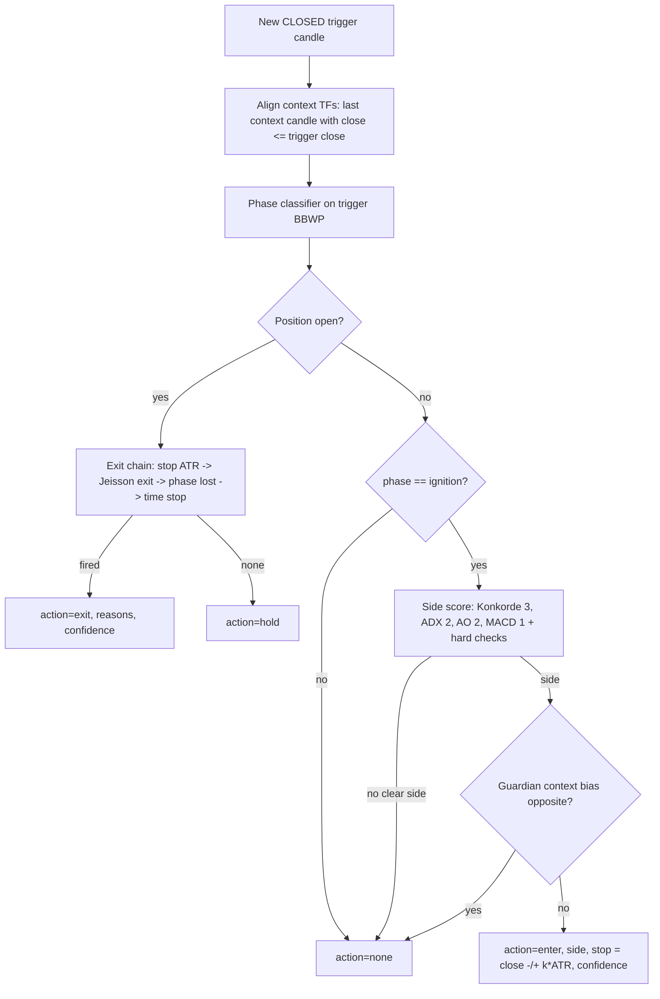

# Impulse engine v2 ("impulsos-v2") — rule spec

| | |
|---|---|
| **rule_version** | `impulse-2.0.0` |
| **Status** | Spec for `backend`. NOT active. Paper-first gates in §h. |
| **Author / date** | trading analyst, 2026-11-01 (branch `impulsos-v2`, after Konkorde audit `406b69c`) |
| **Goldens** | `tests/fixtures/impulse_golden_cases.json` (14 cases) |
| **Scope** | NEW additive engine. `rules_service.py` (legacy vote engine) and its watcher output stay untouched. |

Owner (Jeisson) does not hold longs: he trades **impulses in both directions**.
The legacy engine (sign vote, entry = buy, exit = leave the long) cannot short and
cannot see turns. This engine models one impulse cycle per trigger timeframe:
**compression -> ignition -> expansion -> exhaustion -> contraction**, with the
trade opened at ignition (side decided by Konkorde/ADX/AO/MACD, filtered by the
context timeframes) and closed by the owner's exit rule or a protective exit.

Reused, not reinvented: spec §0 (closed candles, multi-TF alignment, TF bands,
rule_version), E1 `adx_turn`, E2 `ao_divergence` + AO zero-cross, E5 regime
(>50) and its addenda (zones, `v_turn_low` low zone = 30, `zone_jump`), §F
ladder (guardian TF), §H profiles. Forbidden and NOT used: FEC/FEP and any
false-entry machinery (decisions.md D16/D17).

---

## a. Model and flow



Output of every evaluation (one per symbol x profile x closed trigger candle):

```json
{"rule_version": "impulse-2.0.0", "symbol": "BTC/USDT", "profile": "pro",
 "trigger_tf": "4h", "candle_close": "2026-10-31T20:00:00Z",
 "action": "enter|exit|hold|none", "side": "long|short|none", "phase": "...",
 "confidence": 0.0, "reasons": ["..."], "side_score": 0.0,
 "context_bias": {"1d": 1, "1w": 0}, "stop_price": null, "exit_price": null}
```

Engine reads dataframe columns (not the `/v1/metrics` result dict). Exact names
(verified `indicators_service.py`): `close, high, low, bbwp` (definition
`"tv"` = `bbwp_owner.py`, SMA13 basis, lookback 256, MA5 — the rule doc must
pin `bbwp_definition: "tv"`), `konkorde_marron, konkorde_media,
konkorde_azul, konkorde_verde, adx14, plus_di, minus_di, ao, macd,
macd_signal, atr14`. Gotcha: the df column is `atr14` but the result-dict key
is `atr`; use the df.

Notation: `x[-1]` = last CLOSED candle (spec §0.1). Forming candle dropped
before computing anything.

### Konkorde line choice (decision)

`edge = konkorde_marron - konkorde_media` is THE Konkorde line of this engine,
for both side and exit. **Why**: it is Blai5's own signal (marron/media
cross), it is centred on zero on every TF (marron itself sits ~+55 and the
"cross of 0" on it is meaningless after D18), and it is what
`_classify_konkorde` already uses; `azul` (NVI) only moves on low-volume bars
(step-like, noisy) so it is a strength qualifier (`strong_hands`), not the
trigger. `oscp` (verde - marron) is not used in v2.0.0.

---

## b. Phases by BBWP (trigger TF, closed candles)

| Phase | Condition (evaluated top-down, first match wins) | Meaning |
|---|---|---|
| `exhaustion` | `bbwp[-1] >= 90` OR (`max(bbwp[-3..-1]) >= 90` AND a `red_drop` event in the last 3 bars) | red zone / rollover from it |
| `ignition` | `bbwp[-1] > 50` AND `breakout_age <= 2` AND `compression_recent` AND `bbwp > 50` on every bar since the cross | leaving compression = impulse born |
| `expansion` | `bbwp[-1] > 50` | impulse running (owner filter >50) |
| `compression` | `bbwp[-1] <= 30` | spring loading (E5 addendum `low_zone_abs`) |
| `contraction` | `30 < bbwp[-1] <= 50` AND `max(bbwp[-10..-2]) > 50` | volatility leaving the regime |
| `building` | otherwise (`30 < bbwp[-1] <= 50`, no recent >50) | neutral |

Definitions:

* `compression_recent` = `min(bbwp[-10..-1]) <= 30` (`compression_max=30`,
  `compression_lookback=10` bars, current bar included).
* `breakout` (the owner's >50 filter as an EVENT): bar `c` with
  `bbwp[c-1] <= 50 < bbwp[c]`; `breakout_age = index(-1) - c`;
  `breakout_ttl = 3` bars (age 0, 1, 2 allowed).
* `red_drop` event at bar `k`: `bbwp[k-1] >= 90` AND `bbwp[k-1] - bbwp[k] >= 8`
  (one single candle; 7.9 does not count).
* `zone_jump` (E5 addendum): the breakout bar skips >= 2 zones
  (blue[0,20) -> yellow[50,80) or red). Only feeds confidence.
* Entry is forbidden at `bbwp[-1] >= 90` (late: phase is `exhaustion` anyway).

---

## c. Side rule

Four votes `v in {-1, 0, +1}` on the trigger TF, closed bar `-1`:

| Element | Weight | +1 (long) | -1 (short) | Band |
|---|---|---|---|---|
| Konkorde edge | 3 | `edge[-1] > 0` AND `edge[-1] > edge[-2]` | `edge[-1] < 0` AND `edge[-1] < edge[-2]` | `high_tf` only (§0.3) |
| ADX | 2 | `plus_di > minus_di` AND `adx_slope3 >= 0.5` | `minus_di > plus_di` AND `adx_slope3 >= 0.5` | both |
| AO | 2 | (`ao > 0` AND `ao[-1] > ao[-2]`) OR `ao_divergence_bullish` active (E2, ttl 10) | mirror (`ao < 0` falling, or bearish divergence active) | both |
| MACD | 1 | `macd > macd_signal` | `macd < macd_signal` | both |

`adx_slope3 = (adx14[-1] - adx14[-4]) / 3` (E1 `turn_window=3`; 0.5 pts/bar =
"ADX rising", half of E1 `min_slope`). If AO is positive-rising AND a bearish
divergence is active (or mirror), AO vote = 0.

`S = sum(w * v) / sum(w)` with `sum(w) = 8` on `high_tf`, `5` on `low_tf`
(Konkorde removed, reason `band_konkorde_excluded`).

Side resolution (all required, else `side = none`, reason `side_ambiguous`):

1. `S >= +0.5` -> long candidate; `S <= -0.5` -> short candidate
   (`low_tf`: threshold 0.6, because only 5 weight points remain).
2. Hard: dominant DI agrees with the side (`plus_di > minus_di` for long).
   Else `di_against_side`.
3. Hard (`high_tf`): Konkorde vote is not against the side. Else
   `konkorde_against_side`.

No weighted tie-breaking, no "best guess": if no clear side -> no entry.

---

## d. Entry, exit and confidence

### Entry (position flat)

`enter(side)` iff ALL:

1. `phase == ignition` (implies compression_recent + breakout within 3 bars + BBWP > 50 and < 90);
2. side resolved per §c;
3. context permits the side (§e).

Fill = `close[-1]`. `stop_price = close[-1] -/+ stop_atr_mult(profile) * atr14[-1]`.
`1R = |entry - stop_price|`. No fixed target (exit by rule, §f). One position
per symbol x profile; no pyramiding; no automatic flip (§F); a new entry needs a
new compression -> ignition cycle.

Reasons emitted on entry (codes): `bbwp_compression_recent`,
`bbwp_breakout_from_compression`, optional `bbwp_zone_jump`; the agreeing votes
`konkorde_edge_positive|negative`, `adx_di_bullish|bearish`, `ao_bullish|bearish`,
`macd_bullish|bearish`; optional `adx_turn_up`, `konkorde_edge_cross_up|down`,
`ao_zero_cross_up|down`, `konkorde_strong_hands_agree`,
`ao_divergence_bullish|bearish`; context `context_aligned` (guardian bias ==
side) or `context_neutral`.

No-entry reasons: `no_compression_breakout`, `side_ambiguous`,
`di_against_side`, `konkorde_against_side`, `context_against`,
`context_missing`, `band_konkorde_excluded` (informational).

### Exit chain (position open; first match wins, evaluated on the closed bar)

| # | Code | Rule | Fill (backtest) | confidence |
|---|---|---|---|---|
| 1 | `exit_stop_atr` | long: `low[-1] <= stop_price`; short: `high[-1] >= stop_price` | `stop_price`, or `open` if it gapped beyond | 1.0 |
| 2 | `exit_rule_jeisson` (+ `exit_bbwp_red_drop`, + `exit_konkorde_cross_against` / `exit_ao_cross_against`) | a `red_drop` event AND an against-cross event, both inside the last 3 closed bars (`-3..-1`), at least one of them ON bar `-1` (order free) | `close[-1]` | `0.6 + 0.2*min(1,(drop-8)/12) + 0.2*g`, `g=1` same bar, `0.5` one bar apart, `0` two apart |
| 3 | `exit_phase_lost` | `bbwp[-1] <= 50` AND trend line against (high_tf: `edge[-1] < 0` for long / `> 0` for short; low_tf: `ao` sign against) | `close[-1]` | 0.6 |
| 4 | `exit_time_stop` | `bars_held >= time_stop_bars(profile)` AND unrealised `< +0.5 R` | `close[-1]` | 0.5 |

Against-cross event at bar `j` (the owner's "Konkorde girando contra la
posición y cruzando el 0"):

* long: `edge[j-1] >= 0 AND edge[j] < 0` (+ -> -)
* short: `edge[j-1] <= 0 AND edge[j] > 0` (- -> +)
* `low_tf` profiles (Konkorde banned below 4h, §0.3): the leg is the AO zero
  cross against (`ao_zero_cross_down` for long / `_up` for short, E2 semantics),
  code `exit_ao_cross_against`. **Assumption, owner to confirm.**

Window semantics, explicit: drop on bar 1 and cross on bar 3 -> exit at bar 3;
cross on bar 4 -> NO exit (drop left the window). A 7-point drop never counts.
`bars_held` = closed trigger bars since the entry bar (entry bar = 0).

Hold (no exit fired): reason `hold_exit_incomplete` if exactly one Jeisson leg
is inside the window; else `hold_expansion_healthy` if phase in
{ignition, expansion} and `S_dir > 0`; else `hold_no_exit_condition`.
`S_dir` = side score signed toward the open position (no hard checks).

### Confidence (0-1, reported; NOT a gate in 2.0.0 — backtest stratifies by tercile)

Entry:

```
confidence = clamp(0.35*|S| + 0.20*ctx_frac + 0.15*ignition_q
                   + 0.10*adx_turn + 0.10*fresh_cross + 0.10*strong_hands, 0, 1)
```

* `ctx_frac` = context TFs with bias == side / context TFs with data.
* `ignition_q` = 1 if `min(bbwp[-10..-1]) <= 20` (blue) or `zone_jump` on the breakout bar.
* `adx_turn` = 1 if E1 `adx_turn_up` (defaults 3/5/1.0/1.5/10) with DI on the side, at bar -1.
* `fresh_cross` = high_tf: edge crossed 0 toward the side within the last 5 bars; low_tf: AO zero cross toward the side within 5 bars.
* `strong_hands` = high_tf: `sign(konkorde_azul[-1]) == side`; low_tf: E2 divergence toward the side active.

Hold: `0.5*max(0, S_dir) + 0.5*[phase in {ignition, expansion}]`. Exit: table above.

---

## e. Multi-TF context

Per context TF (closed per §0.2: a context candle counts only if its close time
<= trigger candle close time; e.g. 4h trigger closing 08:00 uses the 1d candle
that closed 00:00, never the forming day):

```
ctx_score = 3*sign(edge) + 2*sign(plus_di - minus_di) + 2*sign(ao) + 1*sign(macd - macd_signal)
bias = +1 if ctx_score >= +3 ; -1 if ctx_score <= -3 ; else 0      (NaN component -> 0)
```

* **Guardian** = first context TF of the profile (§F ladder). A side is
  allowed iff `guardian_bias != -side`. Guardian all-NaN -> `context_missing`, no entry.
* Higher context TFs only move `ctx_frac` (conviction cascade, §F). They never
  block in 2.0.0.
* Data gotcha: 1M Konkorde needs ~105 monthly bars and BBWP 256 months — not
  available on bitget BTC/USDT; 1M bias will be NaN (ignored, logged). 1w BBWP
  needs ~256 weeks of warmup: fetch from 2019 or BBWP context is NaN (BBWP is
  not used in context anyway).

---

## f. Profiles

Rule of the owner: wider zoom = less leverage. Leverage never changes signals,
only sizing (`sizing_profiles` parity). Position size = `equity * risk% / 1R`;
if notional / equity would exceed max leverage, size DOWN (never widen the
stop). Liquidation guard: `stop distance <= 0.5 * (1 / leverage)` or skip.

| Profile | Trigger TF | Context (guardian first) | Band | Max lev | Margin | Risk / trade | Stop ATR mult | Exit policy | time_stop_bars | Watcher cadence |
|---|---|---|---|---|---|---|---|---|---|---|
| `scalper` (NEW) | 15m | 1h, 4h | low_tf | 10x | isolated | 0.25% | 2.0 | no target, exit chain (AO leg) | 32 (8h) | every 15m close +30s |
| `snipper` | 1h | 4h, 1d | low_tf | 10x | isolated | 0.50% | 1.5 | no target, exit chain (AO leg) | 48 (2d) | every 1h close +30s |
| `pro` | 4h | 1d, 1w | high_tf | 5x | isolated (see note) | 0.75% | 1.5 | no target, exit chain | 30 (5d) | every 4h close +60s |
| `ancient` | 1d | 1w, 1M | high_tf | 2x (default 1x) | isolated | 1.00% | 2.0 | no target, exit chain | 30 (30d) | daily 00:05 UTC |

* **scalper**: E16 fee drag at 15m is the worst of the ladder (~0.45 R at
  2.0 ATR, extrapolated from 30m 0.41 R at 1.5 ATR) — wider stop to cut drag,
  smallest risk, leverage capped at snipper's 10x (not higher) because low TF
  noise plus leverage is how accounts die; expected NO-PASS on costs until
  proven otherwise. 1h is an alignment TF (same low band), 4h is the guardian.
* **snipper**: keeps today's 10x isolated cap; 1h band forbids Konkorde, so
  side = ADX/AO/MACD only, guardian 4h carries Konkorde.
* **pro**: today's mmk-api has 5x **cross**; recommend isolated during paper so
  one bad trade cannot drain the account — leverage cap unchanged.
* **ancient**: §H said 0x, mmk-api caps 2x; shorts are impossible on spot, so
  ancient shorts need perps at >= 1x. Proposal: longs spot 1x, shorts perp 1x,
  2x only after live-tiny gate.

---

## g. Backtest protocol (PRE-REGISTERED — no parameter change after first run)

* **Market / data**: BTC/USDT, bitget spot OHLCV via `market_data_service`
  (ccxt). Warmup fetched before the window (>= 300 trigger bars; 1w from 2019).
* **Window**: 2024-11-01 00:00 UTC -> 2026-10-31 23:59 UTC.
  **In-sample** 2024-11-01 -> 2025-12-31 (14 months); **out-of-sample**
  2026-01-01 -> 2026-10-31 (10 months). Parameters are set a priori in this
  doc (nothing is fitted on IS); the split is a stability check. Any change
  after seeing results = new `rule_version` + new pre-registration.
* **Cells**: profile x direction: `pro@4h` long, `pro@4h` short,
  `ancient@1d` long, `ancient@1d` short (mandatory). `snipper@1h` and
  `scalper@15m` optional/informational in this run (must pass their own run
  before paper).
* **Execution model**: signal on bar close, fill at `close` + 0.05% slippage;
  fee 0.10% per side (conservative spot taker); stop fills at stop or worse
  open; when stop and rule exit coincide on a bar, stop wins (worst case).
  Perp funding 0.01% per 8h held charged to every short and every leveraged
  trade, regardless of sign (conservative). Costs in R:
  `cost_R = (fee + slip) * (entry + exit) / stop_distance` (E16,
  `SetupBacktestService._simulate_outcome`). Declared drag (E16, 1.5 ATR):
  1h 0.28 R, 4h 0.14 R, 1d 0.055 R per round trip (ancient at 2.0 ATR ~0.04 R).
* **R**: `1R = |entry - initial stop|`; trade R = signed move / 1R - cost_R - funding_R.
* **Metrics per cell** (IS, OOS, total): n, win rate, expectancy net R (mean),
  median R, profit factor net, max drawdown in R (cumulative R curve),
  avg bars held, exit-reason distribution, bootstrap 95% CI of expectancy
  (10 000 resamples, seed 42), confidence-tercile breakdown (informational).
* **Verdict per cell**:
  * `INCONCLUSIVE` if `n_total < 30` (whatever the sign).
  * `PASS` iff `n_total >= 30` AND `expectancy_net_total >= +0.10 R` AND
    CI95 lower bound `> 0` AND `n_oos >= 10` with `expectancy_net_oos > 0`
    AND `expectancy_net_is > 0` AND `PF_net >= 1.2` AND `maxDD <= 10 R`.
  * `NO-PASS` otherwise.
  * Honest expectation: 1d over 2 years will likely give < 30 trades per
    direction -> INCONCLUSIVE; the pre-registered follow-up is the same rules
    on ETH/USDT and SOL/USDT (pooled), NOT a looser threshold.
* **Old vs new**: legacy = `RulesService` as it is on this branch (post-D18:
  TV BBWP, marron vs media) through the existing `BacktestService`, long only,
  `medium` sizing (1.5 ATR stop, 3R target), SAME data, window and costs.
  Report: legacy-long vs new-long per TF (like for like); legacy-short cells
  printed as `N/A — legacy cannot emit shorts` (never as 0 trades / 0 R); new
  long+short combined vs legacy-long only as a separate informational line;
  buy-and-hold % of the window as context.
* **Gotcha**: a backtest of the new engine must run on closed candles and
  aligned context (§e) — reuse the no-peek-ahead test pattern
  (`test_backtest_no_peek_ahead`) for the multi-TF path.

---

## h. What is missing to activate it

1. `backend`: rule doc as versioned data (`impulse-2.0.0`, all params of this
   spec, `bbwp_definition: "tv"`), evaluator + exit chain, band validation
   (Konkorde forbidden in low_tf at load time), closed-candle drop in the live
   path. All 14 goldens in `tests/fixtures/impulse_golden_cases.json` green,
   plus E1/E2 goldens reused. No golden edited to make code pass.
2. Backtest per §g, results pasted below, verdict per cell. Only PASS cells move on.
3. Paper via watcher for >= 30 days AND >= 30 closed paper trades per passing
   cell (whichever is later), signals logged with `rule_version`, paper vs
   backtest expectancy within the backtest CI.
4. `/mmk-council` gate before any real money; leverage > 1x only after the
   live-tiny gate (§H). Default answer until then: not yet.

Parameters summary (all `[calibrable]`, change = version bump):
`compression_max=30, compression_lookback=10, breakout_level=50 (strict),
breakout_ttl=3, exhaustion_level=90, red_drop_min=8 (one bar),
exit_window=3, adx_rising_slope=0.5, side_threshold=0.5 (high_tf) / 0.6
(low_tf), weights K3/ADX2/AO2/MACD1, ctx_bias_threshold=3, fresh_cross_bars=5,
blue_level=20, E1/E2 defaults unchanged.`

Owner ambiguities and the assumption taken:

* "Konkorde crossing 0": taken as `edge = marron - media` crossing 0.
* "Red zone >= 90": the E5 color table put red at >= 80; this engine uses the
  owner's 90 for both exhaustion phase and exit peak; 80 not used.
* "3-candle window": order-free, both legs inside bars -3..-1, one on -1.
* Exit rule on low_tf profiles: Konkorde leg replaced by AO zero cross (band rule).
* Ancient leverage: 0x (§H) vs 2x (mmk-api) -> 1x default, 2x cap.
* "MACD" weight: lowest (1), it is a lagging duplicate of AO/Konkorde momentum.

## Backtest results

Run 2026-11-01 per §g (pre-registration `docs/PREREG_IMPULSOS_v2.md`, commit
`26404e4`, frozen before the first run). Full detail, data manifest and
method notes: `docs/impulsos-v2-backtest.md`. BTC/USDT bitget spot, IS
2024-11-01 -> 2025-12-31, OOS 2026-01-01 -> 2026-10-31, net R after fees,
slippage and funding; CI = cluster bootstrap, seed 42.

| Cell | Engine | n (IS/OOS) | exp. R net total | CI95 | exp. IS | exp. OOS | PF | max DD R | Verdict |
|---|---|---|---|---|---|---|---|---|---|
| 1d long | legacy medium 1.5/3R | 25 (17/8) | +0.215 | [-0.590, 1.101] | +0.111 | +0.437 | 1.30 | 9.0 | INCONCLUSIVE (n<30) |
| 1d long | new ancient | 7 (6/1) | +0.220 | [-0.711, 1.560] | +0.327 | -0.421 | 1.52 | 2.7 | INCONCLUSIVE (n<30) |
| 1d short | legacy | N/A — legacy cannot emit shorts | | | | | | | N/A |
| 1d short | new ancient | 7 (5/2) | -0.363 | [-0.956, 0.304] | -0.440 | -0.169 | 0.42 | 3.2 | INCONCLUSIVE (n<30) |
| 4h long | legacy medium 1.5/3R | 137 (81/56) | -0.141 | [-0.434, 0.161] | -0.073 | -0.238 | 0.84 | 31.1 | NO-PASS |
| 4h long | new pro | 41 (22/19) | +0.146 | [-0.368, 0.834] | +0.615 | -0.397 | 1.25 | 8.0 | NO-PASS (CI, OOS) |
| 4h short | legacy | N/A — legacy cannot emit shorts | | | | | | | N/A |
| 4h short | new pro | 43 (20/23) | -0.374 | [-0.791, 0.188] | -0.576 | -0.199 | 0.55 | 16.2 | NO-PASS |
| 1h long (info) | new snipper | 140 (83/57) | -0.306 | [-0.783, 0.340] | -0.108 | -0.594 | 0.71 | 55.7 | NO-PASS |
| 1h short (info) | new snipper | 153 (91/62) | -0.284 | [-0.663, 0.225] | -0.457 | -0.029 | 0.72 | 45.8 | NO-PASS |

**Verdict: no cell passes; nothing moves to paper.** ancient: INCONCLUSIVE
(7 trades per direction in 2 years) -> pre-registered follow-up is the same
rules on ETH/USDT + SOL/USDT pooled, not a looser threshold. pro long beats
legacy on the total (+0.146 vs -0.141 R, DD 8 vs 31 R) but its OOS half is
negative and worse than legacy's, so the improvement is not established.
Buy-and-hold over the window: +11.6%.
